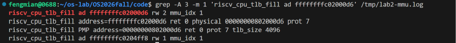

# Lab2：GDB 调试与 Sv39 地址转换机制分析

## 1. 实验目的

本部分实验使用 QEMU 和 GDB 调试 RISC-V 内核启动过程，重点观察 `satp` 寄存器的变化，理解 Sv39 分页机制、页表地址转换过程以及 TLB 的作用。

此外，结合 QEMU 提供的 MMU 调试日志，观察模拟器的 TLB 填充与地址转换过程，将实际运行日志与 GDB 调试结果进行对照验证。本次进一步使用宿主机 GDB 调试 QEMU 7.0.0 源码，验证 `riscv_cpu_tlb_fill()`、`get_physical_address()` 和 `tlb_set_page()` 的执行关系。

## 2. 实验环境

- 操作系统：Ubuntu 22.04.5 LTS（WSL2）
- 目标架构：RISC-V 64
- 模拟器：QEMU 7.0.0
- 调试工具：RISC-V GDB（内核调试）、GNU GDB 12.1（QEMU 宿主机源码调试）
- QEMU 源码：`/home/fengmian/qemu-7.0.0/`
- QEMU 程序：`/opt/qemu/bin/qemu-system-riscv64`（带调试信息，未剥离符号）
- 实验内核：uCore
- 交叉编译器：RISC-V GCC 15.1.0

本实验使用修复后的启动环境，`Makefile` 采用 `-kernel` 参数加载内核镜像，`entry.S` 的启动页表同时包含低地址恒等映射和高地址映射。课程规定的 QEMU 启动入口保持为 `make qemu`，必要时通过 `QEMUOPTS` 传递调试参数。

## 3. 实验过程

### 3.1 启动 QEMU 与 GDB

在 `code` 目录下启动 QEMU：

```bash
make qemu QEMUOPTS="-s -S"
```

其中，`-s` 用于启动 GDB 调试服务，`-S` 使 CPU 在启动时暂停，等待调试器连接。

在另一个终端执行：

```bash
make gdb
```

连接成功后，设置内核物理入口断点：

```gdb
break *0x80200000
continue
info registers pc
info registers satp
```

得到：

```text
pc   = 0x80200000
satp = 0x0
```

此时内核已经到达物理入口地址，但还没有启用 Sv39 分页。

### 3.2 观察 Sv39 分页开启过程

使用 GDB 反汇编内核入口附近的指令：

```gdb
x/35i $pc
```

发现两条关键指令：

```asm
0x80200034: csrw satp,t0
0x80200038: sfence.vma
```

在写入 `satp` 之前设置断点：

```gdb
break *0x80200034
continue
```

检查寄存器：

```text
pc   = 0x80200034
t0   = 0x8000000000080205
satp = 0x0
```

执行单步调试：

```gdb
si
info registers pc
info registers satp
```

结果为：

```text
pc   = 0x80200038
satp = 0x8000000000080205
```

说明执行 `csrw satp,t0` 后，CPU 的地址转换模式已经由 Bare 切换为 Sv39。

对 `satp` 的分析如下：

- MODE = 8：使用 Sv39 分页模式。
- ASID = 0：地址空间标识符为 0。
- PPN = 0x80205：根页表的物理页号。

因此根页表物理地址为：

```text
0x80205 × 4096 = 0x80205000
```

接着执行 `sfence.vma`：

```gdb
si
info registers pc
info registers satp
```

得到：

```text
pc   = 0x8020003c
satp = 0x8000000000080205
```

说明 `sfence.vma` 已执行，`satp` 的值保持不变。该指令用于同步地址转换相关状态，使后续地址转换遵循相应的页表配置。

### 3.3 分析 Sv39 根页表

使用 GDB 查看根页表：

```gdb
x/4gx 0x80205000
```

结果：

```text
0x80205000:
0x0000000000000000  0x0000000000000000

0x80205010:
0x00000000200000cf  0x0000000000000000
```

因此：

```text
PTE[2] = 0x200000cf
```

继续查看根页表的第 511 项：

```gdb
x/gx 0x80205ff8
```

结果：

```text
PTE[511] = 0x200000cf
```

两个页表项具有相同的值，说明它们映射到同一个物理内存区域。

其中，`0x200000cf` 的低位标志包含：

- V = 1：有效
- R = 1：可读
- W = 1：可写
- X = 1：可执行
- A = 1：已访问
- D = 1：已修改

由于这两个页表项位于 Sv39 根页表中，并且设置了读写执行权限，因此它们是叶子页表项，形成 1 GiB 大页映射。

Sv39 通常采用三级页表结构，但允许在较高层级直接使用大页。本实验启动阶段的映射就在根页表层级结束，没有继续访问下两级页表。

### 3.4 验证虚拟地址与物理地址转换

内核的高虚拟地址为：

```text
0xffffffffc02000d6
```

在 GDB 中计算该地址的 VPN[2]：

```gdb
p/x (0xffffffffc02000d6 >> 30) & 0x1ff
```

结果：

```text
$1 = 0x1ff
```

即根页表索引为 511。

对低地址进行同样的计算：

```gdb
p/x (0x802000d6 >> 30) & 0x1ff
```

结果：

```text
$2 = 0x2
```

即根页表索引为 2。

由于两个根页表项均指向物理地址 `0x80000000` 开始的 1 GiB 区域，因此对于该高虚拟地址：

```text
物理地址 = 0x80000000 + (虚拟地址 & 0x3fffffff)
```

在 GDB 中执行：

```gdb
p/x 0x80000000 + (0xffffffffc02000d6 & 0x3fffffff)
```

结果：

```text
$3 = 0x802000d6
```

说明：

```text
高虚拟地址：0xffffffffc02000d6
对应物理地址：0x802000d6
```

这验证了当前页表的高地址映射关系。

### 3.5 验证内核高虚拟地址执行

在 `kern_init()` 入口设置断点：

```gdb
break *0xffffffffc02000d6
continue
```

成功命中断点：

```text
Breakpoint 3, kern_init () at kern/init/init.c:30
```

查看寄存器：

```text
pc   = 0xffffffffc02000d6
satp = 0x8000000000080205
```

进一步反汇编：

```gdb
x/4i $pc
```

得到：

```asm
0xffffffffc02000d6 <kern_init>:     auipc a0,0x6
0xffffffffc02000da <kern_init+4>:   addi  a0,a0,-190
0xffffffffc02000de <kern_init+8>:   auipc a2,0x6
0xffffffffc02000e2 <kern_init+12>:  addi  a2,a2,-102
```

说明 CPU 已经成功到达内核高虚拟地址，且仍处于 Sv39 分页模式。

### 3.6 QEMU MMU 日志与 TLB 填充验证

前面通过 GDB 观察了分页开启、根页表内容以及虚拟地址到物理地址的计算过程。为了进一步验证实际运行中的地址转换，使用 QEMU 的 MMU 日志功能记录内核执行时的地址转换活动。

#### 3.6.1 检查 QEMU 日志功能

在终端执行：

```bash
qemu-system-riscv64 -d help
```

发现当前 QEMU 支持以下调试选项：

```text
mmu    log MMU-related activities
int    show interrupts/exceptions in short format
```

其中，`mmu` 用于输出 MMU 相关活动，`int` 用于输出异常和中断相关记录。

#### 3.6.2 启用 MMU 调试日志

为了保持课程要求的 `make qemu` 启动方式，在 `Makefile` 的 QEMU 启动命令末尾增加可选参数变量：

```makefile
-kernel $(UCOREIMG) $(QEMUOPTS)
```

普通运行仍然执行：

```bash
make qemu
```

进行 MMU 调试时执行：

```bash
make qemu QEMUOPTS="-d mmu,int -D /tmp/lab2-mmu.log"
```

其中：

- `-d mmu,int`：开启 MMU 与异常相关日志。
- `-D /tmp/lab2-mmu.log`：将日志写入指定文件。

运行后成功生成：

```text
/tmp/lab2-mmu.log
```

该次日志大小约为 346 KB。

#### 3.6.3 提取高虚拟地址的 TLB 填充记录

通过以下命令筛选内核高虚拟地址的访问记录：

```bash
grep -Ei 'riscv_cpu_tlb_fill (ad|address=) ffffffff' /tmp/lab2-mmu.log | head -40
```

其中，发现之前 GDB 调试过的 `kern_init()` 入口地址：

```text
riscv_cpu_tlb_fill ad ffffffffc02000d6 rw 2 mmu_idx 1
```

为了查看该地址对应的完整转换结果，进一步执行：

```bash
grep -A 3 -m 1 'riscv_cpu_tlb_fill ad ffffffffc02000d6' /tmp/lab2-mmu.log
```

得到：

```text
riscv_cpu_tlb_fill ad ffffffffc02000d6 rw 2 mmu_idx 1
riscv_cpu_tlb_fill address=ffffffffc02000d6 ret 0 physical 00000000802000d6 prot 7
riscv_cpu_tlb_fill PMP address=00000000802000d6 ret 0 prot 7 tlb_size 4096
riscv_cpu_tlb_fill ad ffffffffc0204ff8 rw 1 mmu_idx 1
```

其中：

- `ad ffffffffc02000d6`：待转换的内核高虚拟地址。
- `rw 2`：表示指令取指访问。
- `mmu_idx 1`：QEMU 内部使用的 MMU 上下文索引。
- `ret 0`：本次地址转换成功。
- `physical 00000000802000d6`：转换得到的物理地址。
- `prot 7`：QEMU 内部记录的访问权限掩码。
- `tlb_size 4096`：此次 QEMU 内部 TLB 缓存记录的粒度为 4096 字节。

需要注意，启动页表采用的是 1 GiB 大页映射，而日志中的 `tlb_size 4096` 是此次模拟器内部缓存记录的粒度，并不表示 Sv39 的映射页大小变成了 4 KiB。



#### 3.6.4 对照 Sv39 页表分析结果

前面通过 GDB 已经得到：

```text
satp = 0x8000000000080205
根页表物理地址 = 0x80205000
VPN[2] = 511
PTE[511] = 0x200000cf
```

根据根页表中的 1 GiB 大页映射关系，计算得到：

```text
虚拟地址：0xffffffffc02000d6
           ↓
根页表项：PTE[511]
           ↓
物理地址：0x802000d6
```

而本次 QEMU 日志实际记录：

```text
address=ffffffffc02000d6
ret 0
physical 00000000802000d6
```

两次结果完全一致。

由此说明，QEMU 对内核高虚拟地址的取指访问成功完成了地址转换，并得到了与 GDB 页表分析一致的物理地址。

QEMU 的 `riscv_cpu_tlb_fill` 日志可以作为模拟器执行地址转换和 TLB 填充处理的证据，但它并不直接提供真实硬件的 TLB 命中率，也不代表已经观察到所有内部页表遍历步骤。

### 3.7 QEMU 源码级 GDB 调试与 TLB 填充验证

前面的实验分别利用 RISC-V GDB 观察 uCore 内核状态、利用 QEMU MMU 日志获取地址转换记录。为了进一步理解日志对应的模拟器内部实现，本节使用运行在 WSL 上的宿主机 GNU GDB 直接调试 QEMU 7.0.0 程序。

需要区分的是，`make gdb` 连接的是 QEMU 的远程调试接口，用于查看 RISC-V 虚拟 CPU 和 uCore；宿主机 `gdb` 调试的是 QEMU 的 x86-64 进程本身。本节实际完成的是这两种视角的分别验证，**没有同时运行两个 GDB 完成同步单步**。

#### 3.7.1 检查 QEMU 调试环境

QEMU 可执行文件路径为：

```text
/opt/qemu/bin/qemu-system-riscv64
```

使用 `file` 检查，确认该程序包含 `debug_info` 且 `not stripped`。本机还保留源码目录：

```text
/home/fengmian/qemu-7.0.0/target/riscv/cpu_helper.c
```

宿主机调试器使用 GNU GDB 12.1。由于现有 QEMU 已具有调试信息，本次没有重新编译 QEMU。

#### 3.7.2 在 RISC-V TLB 处理函数处设置条件断点

进入 `code` 目录，用宿主机 GDB 启动 QEMU 程序：

```bash
cd ~/os-lab/OS2026fall/code
gdb /opt/qemu/bin/qemu-system-riscv64
```

在 GDB 中设置命令行参数并调试启动：

```gdb
set pagination off
break riscv_cpu_tlb_fill
set args -machine virt -nographic -bios default -kernel bin/ucore.img
run
```

第一次命中发生在启动早期，地址为 `0x1000`，属于取指访问，尚不是本次要研究的 uCore 高虚拟地址。于是禁用普通断点，只关注目标地址：

```gdb
disable 1
break riscv_cpu_tlb_fill if address == 0xffffffffc02000d6
continue
```

随后成功命中：

```text
Thread 3 "qemu-system-ris" hit Breakpoint 2,
riscv_cpu_tlb_fill (
    address=18446744072637907158,
    access_type=MMU_INST_FETCH,
    mmu_idx=1,
    probe=false
) at ../target/riscv/cpu_helper.c:1184
```

使用以下命令确认目标地址、观察函数参数和调用路径：

```gdb
p/x address
info args
bt
```

得到：

```text
$1 = 0xffffffffc02000d6
```

调用栈显示取指相关路径为：

```text
tb_lookup / tb_htable_lookup
  → get_page_addr_code
  → get_page_addr_code_hostp
  → tlb_fill
  → riscv_cpu_tlb_fill
```

这一结果表明，QEMU 在获取内核高虚拟地址的指令时，触发了相应的软件 TLB 填充路径。

#### 3.7.3 定位单阶段地址翻译源码

在 `cpu_helper.c` 中查看 `riscv_cpu_tlb_fill()` 函数的后半部分：

```gdb
list 1265,1325
```

观察到普通 Sv39 地址翻译使用单阶段分支：

```c
/* Single stage lookup */
ret = get_physical_address(env, &pa, &prot, address, NULL,
                           access_type, mmu_idx, true, false, false);
```

函数在翻译成功后继续检查 PMP 权限，再执行：

```c
if (ret == TRANSLATE_SUCCESS) {
    tlb_set_page(cs, address & ~(tlb_size - 1),
                 pa & ~(tlb_size - 1),
                 prot, mmu_idx, tlb_size);
    return true;
}
```

因此，当前观察到的路径包括：虚拟地址请求、`get_physical_address()` 转换、PMP 检查以及成功后的 `tlb_set_page()` 填充。

#### 3.7.4 观察 QEMU 计算出的物理地址

在 `riscv_cpu_tlb_fill()` 入口断点处，设置地址翻译调用后的临时断点：

```gdb
tbreak ../target/riscv/cpu_helper.c:1281
continue
```

GDB 实际停在 `cpu_helper.c:1286` 附近的翻译结果判断处。查看变量：

```gdb
p/x address
p/x pa
p ret
```

得到：

```text
(gdb) p/x address
$2 = 0xffffffffc02000d6
(gdb) p/x pa
$3 = 0x802000d6
(gdb) p ret
$4 = <optimized out>
```

其中 `ret` 因编译优化而不能直接读取，但 `pa` 的实际值为 `0x802000d6`，与前文通过 Sv39 根页表计算以及 MMU 日志得到的物理地址一致。随后成功进入 `tlb_set_page()`，进一步验证了正常翻译与填充路径。

#### 3.7.5 在 `tlb_set_page()` 中验证软件 TLB 更新

继续设置一次性断点：

```gdb
tbreak tlb_set_page
continue
bt 4
info args
```

断点成功命中 QEMU 源码 `../accel/tcg/cputlb.c:1281`，调用栈的前几层为：

```text
#0 tlb_set_page(...)
#1 riscv_cpu_tlb_fill(...) at ../target/riscv/cpu_helper.c:1304
#2 tlb_fill(...) at ../accel/tcg/cputlb.c:1313
#3 get_page_addr_code_hostp(...)
```

实际参数为：

```text
vaddr   = 18446744072637906944
paddr   = 2149580800
prot    = 7
mmu_idx = 1
size    = 4096
```

转为十六进制：

```text
vaddr = 0xffffffffc0200000
paddr = 0x80200000
```

与前面按字节转换的结果：

```text
VA 0xffffffffc02000d6 → PA 0x802000d6
```

正好对应同一个页内偏移 `0x0d6`。可见 QEMU 在成功翻译后，调用了 `tlb_set_page()`，把本次虚拟页和物理页的映射加入软件 TLB。`prot=7` 是模拟器表示的读、写、执行权限掩码，`mmu_idx=1` 表示此次使用的 MMU 上下文，`size=4096` 表示这次软件 TLB 项目的填充粒度为 4 KiB。

需要注意：**Sv39 根页表 PTE 使用 1 GiB 大页映射，与 QEMU 本次填充 4 KiB 软件 TLB 条目并不冲突**，两者分别表示页表映射大小与模拟器缓存条目的粒度。

#### 3.7.6 源码级调试结果与限制

本次在 QEMU 7.0.0 源码中实际完成了以下验证：

1. 条件断点准确命中 `riscv_cpu_tlb_fill()` 中目标高虚拟地址的取指访问。
2. 通过调用栈识别 `tlb_fill()` 进入 RISC-V 地址翻译逻辑的路径。
3. 定位 `get_physical_address()` 与 `tlb_set_page()` 的源码位置。
4. 在地址翻译调用后读出 `pa = 0x802000d6`，与内核 GDB、Sv39 手动计算和 MMU 日志相符。
5. 在 `tlb_set_page()` 中命中断点，验证虚拟页与物理页的映射参数。

本次没有在 `get_physical_address()` 内部逐条单步跟踪每次 PTE 读取，也没有实现 QEMU 宿主机 GDB 和 RISC-V 客体 GDB 的同时单步。因此，本节证明的是**QEMU 源码级地址转换与 TLB 填充过程的关键节点**，不把它描述为已完成完整的双 GDB 同步调试或所有三级页表的动态遍历。

## 4. TLB 机制分析

TLB（Translation Lookaside Buffer）用于缓存虚拟地址到物理地址的转换信息，以减少重复页表查询产生的开销。

当 CPU 访问虚拟地址时，地址转换通常涉及以下过程：

1. CPU 发起虚拟地址访问。
2. 检查 TLB 中是否存在可用的地址转换信息。
3. 如果存在有效的缓存结果，可以直接使用该转换信息。
4. 如果没有对应的缓存结果，则需要执行页表查询，获得相应的物理地址和权限信息。
5. 转换结果可以被缓存，以便后续访问使用。

本实验在内核入口观察到了：

```asm
csrw satp,t0
sfence.vma
```

其中，`csrw satp,t0` 配置分页模式和根页表位置；`sfence.vma` 用于同步地址转换相关状态，使后续地址转换正确反映页表配置。

在本次实验中，GDB 显示写入 `satp` 后：

```text
satp = 0x8000000000080205
```

CPU 启用了 Sv39 分页模式。

随后，通过读取根页表，观察到：

```text
PTE[2]   = 0x200000cf
PTE[511] = 0x200000cf
```

这两个页表项分别提供低地址恒等映射和内核高地址映射，均映射到相同的物理内存区域。

在 QEMU 的 MMU 调试日志中，进一步观察到：

```text
riscv_cpu_tlb_fill ad ffffffffc02000d6 rw 2 mmu_idx 1
riscv_cpu_tlb_fill address=ffffffffc02000d6 ret 0 physical 00000000802000d6 prot 7
```

进一步通过 QEMU 源码级 GDB，实际观察到 `get_physical_address()` 调用之后的 `pa=0x802000d6`，并在 `tlb_set_page()` 处命中断点，取得映射页基址 `0xffffffffc0200000 → 0x80200000`。因此，除了页表计算和 QEMU 日志以外，还能够从模拟器 C 源码的实际执行过程验证本次软件 TLB 的填充。

本次实验未直接读取真实硬件的 TLB 内部条目，也没有测量 TLB 命中率。同时，由于启动页表使用的是根页表级别的 1 GiB 大页映射，地址转换在根页表即可完成，不需要继续访问下两级页表。

因此，本次记录主要反映 QEMU 模拟的地址转换与 TLB 填充过程，而不是完整的硬件 TLB 性能测试。

## 5. 实验总结

通过本次调试，我理解了 RISC-V 内核开启 Sv39 分页的基本过程。内核首先准备根页表地址，将 Sv39 配置写入 `satp`，再执行 `sfence.vma` 同步地址转换状态，最后跳转到高虚拟地址继续执行。

实验中读取到的 `PTE[2]` 和 `PTE[511]` 均为 `0x200000cf`，验证了低地址与高地址映射到同一物理内存区域的关系。通过计算 VPN[2] 和物理地址，也进一步理解了 Sv39 的地址转换方法。

本实验使用的是根页表级别的 1 GiB 大页映射，因此虽然 Sv39 支持三级页表，实际启动映射并不需要完整遍历三级页表。

在原有 GDB 调试的基础上，本次还使用了 QEMU 的 `mmu` 调试日志，获取到 `riscv_cpu_tlb_fill` 记录，观察了内核高虚拟地址 `0xffffffffc02000d6` 对应的地址转换过程。日志显示转换成功，得到物理地址 `0x802000d6`，与之前 GDB 的计算结果完全一致。

进一步使用宿主机 GDB 对 QEMU 7.0.0 进行源码级调试，成功捕捉目标地址的取指转换，确认 `get_physical_address()` 执行后的物理地址，并在 `tlb_set_page()` 中观察到了软件 TLB 填充时的实际参数。这使得实验从手动页表计算、模拟器日志分析，扩展到了 QEMU C 源码关键执行位置的验证。

通过本次实验，我对 MMU、Sv39 页表和 TLB 的关系有了更具体的认识：页表保存地址映射关系，MMU 根据页表或缓存的转换信息完成地址转换，而 TLB 的作用是缓存转换结果、提高地址访问效率。相比只阅读源码，GDB 的断点、单步调试和 QEMU MMU 日志能够更直观地帮助理解内核从物理地址启动、开启分页，再到高虚拟地址运行的过程。
