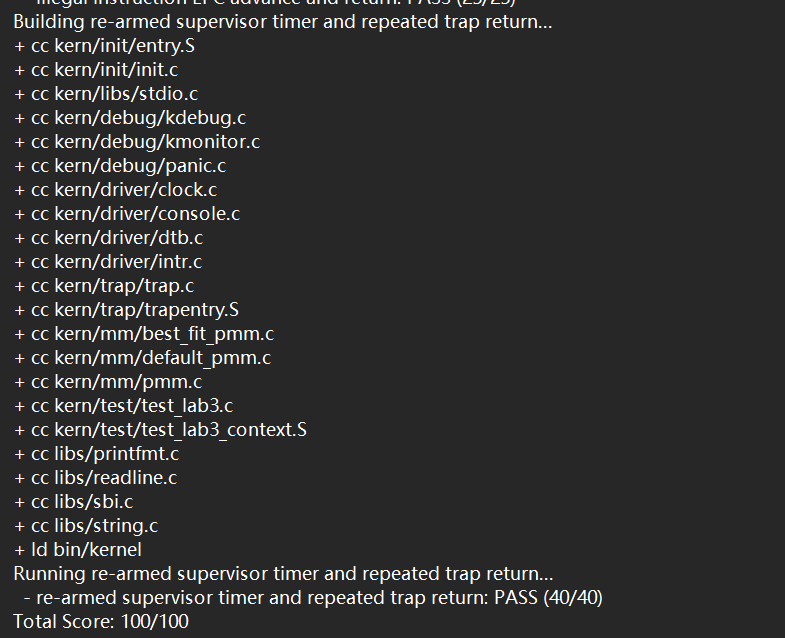
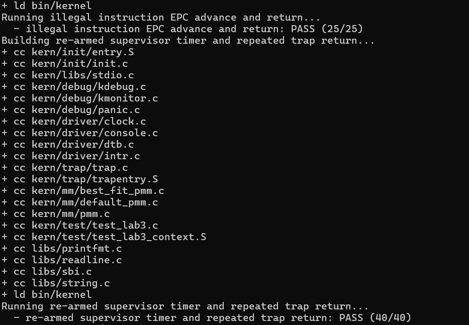
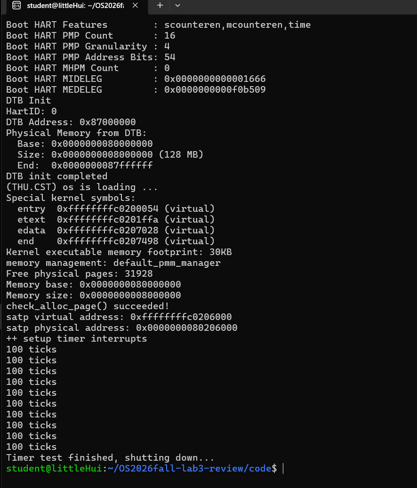

# 操作系统实验三：中断与异常处理（Lab3）实验报告

> 课程：操作系统（2026 Fall，riscv64-ucore）  
> 实验名称：Lab3——断，都可以断  
> 小组仓库：https://github.com/fengmian-coder/OS2026fall  
> 集成分支：`lab3`；复验来源提交：`eea7d0d`  
> 实验环境：WSL Ubuntu 22.04、RISC-V 交叉编译工具链、QEMU、OpenSBI、Git/VS Code  
> 报告整理：李文慧；日期：2026.11.5

| 组内成员 | 学号 | 本次主要责任 |
|---|---|---|
| 张馨月 | 2414029 | `trapentry.S` 中的 Trap 入口、现场恢复、CSR 兼容性处理 |
| 贾璐菡 | 2412074 | `trap.c` 中的 `interrupt_handler()`、持续定时器中断、启动及评分问题协助排查 |
| 李文慧 | 2411785 | `trap.c` 中的 `exception_handler()`、异常返回分析、公共分支复验、最终报告整合与提交检查 |

> **事实与范围说明**：本报告依据组员提供的草稿、贾璐菡的 AI 辅助开发摘要、实际提交和李文慧在公共分支复验的终端记录整理。个人首次编写、团队后续修复和最终集成结果分别表述。自动评分是**本地使用集成分支评分脚本**得到的结果，尚不能替代助教的正式课程验收。旧版 Challenge 不在本年度必做范围之内。组员姓名、其余学号以及尚未提供的原始 Prompt/GDB 截图应在提交前补齐，不虚构不存在的记录。

## 一、实验目的与整体思路

本实验在已有内核启动、物理内存管理的基础上，为 uCore 增加 RISC-V Supervisor 模式下的 Trap 处理能力，重点理解**上下文保存与恢复、Trap 入口与返回、中断和异常的分类处理**。

Trap 分为两类：一是通常由定时器等事件触发的**异步中断**；二是与当前指令直接相关的**同步异常**，例如断点指令 `ebreak` 和非法指令。虽然触发原因不同，进入内核时都通过统一 Trap 入口，并利用 TrapFrame 传递处理器现场。

整体执行过程为：

```text
CPU 发生中断或异常
    │
    ▼
硬件按照 stvec 转到 __alltraps
    │
    ▼
SAVE_ALL：把通用寄存器与关键 CSR 保存到 TrapFrame
    │
    ▼
设置 a0 = sp，调用 trap(struct trapframe *tf)
    │
    ▼
trap_dispatch(tf) 读取 cause 最高位
    ├── 中断 ──> interrupt_handler(tf)
    └── 异常 ──> exception_handler(tf)
    │
    ▼
__trapret / RESTORE_ALL 恢复现场与 sepc、sstatus
    │
    ▼
sret 返回原执行流或异常指令之后
```

实验并不要求新建完整进程调度器，核心是让这个闭环正确执行，并用寄存器恢复、异常指令返回、连续时钟中断验证它。

### 1.1 工程组成和模块分工

| 代码/工具 | 在实验中的作用 | 主要责任 |
|---|---|---|
| `code/kern/trap/trapentry.S` | `SAVE_ALL`、`RESTORE_ALL`、`__alltraps` 和 `sret` 返回 | 张馨月 |
| `code/kern/trap/trap.c` | `trap()`、`trap_dispatch()`、两类 Handler | 贾璐菡、李文慧 |
| `code/kern/trap/trap.h` | `pushregs`、`trapframe` 的结构体布局 | 全组核对接口 |
| `code/kern/driver/clock.c` | 设置下一次时钟事件、维护 `ticks` 等 | 框架已有，贾璐菡调用 |
| `code/kern/driver/intr.c` | 与本地中断使能相关的接口 | 框架已有 |
| `code/kern/init/entry.S` | 启动和分页映射 | 团队集成排错 |
| `code/tools/grade.sh`、`inject.py` | 构建并执行三轮自动测试 | 团队集成验收 |

本组原有的 Lab2 物理内存管理代码也需要在 Lab3 工程中保持可编译和正常初始化，不能仅靠补齐 Trap 函数就认为内核已经可以运行。

## 二、张馨月：Trap 入口与上下文恢复

### 2.1 目标和接口约束（Spec）

张馨月负责在已有 `SAVE_ALL` 和 TrapFrame 布局基础上补齐 `RESTORE_ALL` 与 `__alltraps`，要求：不破坏 `SAVE_ALL` 的保存约定；TrapFrame 地址必须通过 RISC-V 调用约定传给 `trap(tf)`；返回时恢复 `sstatus`、`sepc` 和通用寄存器，最后执行 `sret`。

`struct trapframe` 共包含**32个通用寄存器槽位和4个 CSR 相关槽位**（在RV64中使用机器字宽槽位）。其尾部对应状态为：

| 槽位 | 字段 | 功能 |
|---|---|---|
| 0～31 | x0～x31 | 原始通用寄存器现场 |
| 32 | `status` | 保存 `sstatus` |
| 33 | `epc` | 保存 `sepc`（返回执行位置） |
| 34 | `badvaddr` | 保存故障相关地址字段，当前对应 `stval` |
| 35 | `cause` | 保存 `scause` |

汇编存取偏移必须与 C 结构体严格一致，否则 C Handler 会读到错误的上下文。

### 2.2 处理 CSR 名称兼容性问题

起始 `SAVE_ALL` 中使用 `csrr s3, sbadaddr`，当前工具链提示：

```text
Error: unknown CSR 'sbadaddr'
```

张馨月将其改为：

```asm
csrr s3, stval
```

`stval` 是目前工具链识别的 CSR 名称，读取结果仍保存到 TrapFrame 原有的故障地址槽位。这属于兼容性修正，不涉及重新设计 TrapFrame。

### 2.3 实现上下文恢复 `RESTORE_ALL`

首先从 TrapFrame 恢复与 Trap 返回有关的 CSR：

```asm
LOAD t0, 32*REGBYTES(sp)
csrw sstatus, t0
LOAD t0, 33*REGBYTES(sp)
csrw sepc, t0
```

随后恢复其他通用寄存器，并把原始栈指针 `sp` 的恢复放在最后，例如：

```asm
# Restore original stack pointer LAST
LOAD x2, 2*REGBYTES(sp)
```

原因是：在恢复各寄存器的阶段，当前 `sp` 仍承担访问 TrapFrame 的基址作用。若过早把 `sp` 换回被打断程序的旧值，后续 `LOAD` 将无法再正确读取当前 TrapFrame。

### 2.4 实现 `__alltraps` 与函数参数传递

张馨月的关键代码为：

```asm
__alltraps:
    SAVE_ALL
    mv a0, sp
    jal trap
```

保存完成后，`sp` 指向 TrapFrame 的起始位置。根据 RISC-V 调用约定，`a0` 用于传递第一个函数参数，因此 `mv a0, sp` 把 `struct trapframe *tf` 交给 C 语言 `trap()`。当 C Handler 返回后，再进入 `__trapret` 完成恢复并执行 `sret`。

### 2.5 张馨月遇到的问题和验证

主要问题是旧 CSR 名称引起的汇编失败，以及恢复 `sp` 的顺序容易破坏 TrapFrame 访问。张馨月给出的草稿显示两者已处理。在公共分支的自动评分中，与汇编入口及寄存器恢复直接相关的 Test 1 最终为 **PASS（35/35）**。该测试也依赖李文慧的断点 EPC 处理。

## 三、贾璐菡：中断处理与定时器

### 3.1 中断处理 Spec

贾璐菡负责 `interrupt_handler(struct trapframe *tf)`：解析中断类型，识别 supervisor timer、supervisor software 和未知中断；对 timer 每次调用 `clock_set_next_event()`，增加 `ticks`；每满 `TICK_NUM=100` 次打印一次固定格式文本；不改变 `trap_dispatch()` 的分流方式。

### 3.2 中断原因分类

RISC-V 的 `scause` 最高位代表是否为中断，低位代表原因编号。进入 `interrupt_handler()` 后，贾璐菡使用：

```c
uintptr_t cause = tf->cause & (((uintptr_t)-1) >> 1);
```

这会清除最高位的中断标志，只保留原因编号。当前源码使用 `IRQ_S_TIMER=5`、`IRQ_S_SOFT=1`，不应把包含最高位标志的完整 `scause` 值直接与这两个编号比较。

### 3.3 Timer 中断和持续触发

贾璐菡提供的核心逻辑如下：

```c
case IRQ_S_TIMER:
    clock_set_next_event();
    ticks++;
    if (ticks % TICK_NUM == 0) {
        print_ticks();
    }
    break;
```

其中，`clock_set_next_event()` 重新设置下一次触发时刻；如果缺少这一步，时钟中断可能只触发一次，不能完成连续计数。`ticks` 是累计中断次数，而 `print_ticks()` 每满100次就输出一次字符串 `100 ticks`，所以看到多次相同输出并不表示计数停在100。

### 3.4 软件中断、未知中断与关机

Supervisor software 中断按照测试要求输出 `Supervisor software interrupt`；未知中断输出例如 `Unknown interrupt: cause 15` 的原因编号。在公共集成版本中，未知中断还包含输出 TrapFrame 的诊断兜底逻辑，以方便定位不支持的中断。

公共集成版本补充了计数达到约定阈值后通过 SBI 触发关机的行为。李文慧负责核查它与指导书及 Test 3 的兼容性，最终 `make qemu` 的真实终端输出显示多次 `100 ticks` 和 `Timer test finished, shutting down...`，并正常返回 WSL 命令行。这里的自动关机是**团队集成行为**，。

### 3.5 贾璐菡贡献和测试

贾璐菡曾在 `jlh-lab3` 完成 Handler 并通过 PR #16 集成，随后利用独立诊断工作区排查页表、启动参数和异常指令长度等问题；验证版本另存为 `jlh-lab3-final-100`，之后由团队整合至公共 `lab3`。公共版本 Test 3 为 **PASS（40/40）**，符合连续重设定时器及 `ticks=200` 的评分要求。

## 四、李文慧：异常处理与 EPC 返回

### 4.1 李文慧任务与 Spec

李文慧负责 `code/kern/trap/trap.c` 的 `exception_handler(struct trapframe *tf)`：按 `tf->cause` 区分断点异常、非法指令异常及未知异常；输出规定诊断信息；调整 `tf->epc` 以便 `sret` 返回后继续正确执行；不改动 `trap_dispatch()` 的函数签名和基本分流逻辑。另负责组内约定的未知中断兜底、时钟关机检查、学号注释规范以及公共版本复验和报告整合。

### 4.2 异常类型和返回位置

| 异常 | 原因编号 | 处理方式 | 返回位置 |
|---|---:|---|---|
| Illegal instruction | 2 | 输出 `Illegal instruction at` 及触发位置 | 跳过触发异常的指令 |
| Breakpoint | 3 | 输出 `Breakpoint at` 及触发位置 | 跳过断点指令 |
| 未知异常（测试构造 cause 20） | 20 等 | 使用 `print_trapframe(tf)` 输出诊断现场 | 不擅自做通用异常恢复 |

在最初个人分支 `lwh-lab3` 中，李文慧编写了 `exception_handler()`，完成 `switch(tf->cause)`、输出和兜底，但当时**固定采用 `tf->epc += 4`**。该版本在 `b1e3f42` 提交并推送，单个 C 源文件编译通过。该初版正确处理了4字节测试指令，却没有覆盖压缩指令的情况。

### 4.3 压缩指令长度带来的 Bug

团队在集成测试时发现，Test 1 中的 `ebreak` 被编译成**2字节压缩指令**。原来无条件使用 `epc += 4`，会越过实际的下一条指令，导致断点返回及寄存器上下文检查失败。

根据 RISC-V 压缩指令编码规则，对于当前测试中能读取到的指令，低16位编码的最低两位可用于区分长度：最低两位为 `11` 时按普通4字节指令处理，否则可按2字节压缩指令处理。集成代码据此按实际指令长度推进 `epc`，从而避免原初版固定跳4字节的错误。这项问题由贾璐菡的诊断工作首先定位，后经团队集成修正；我在最终公共版本中核查了异常分支和测试结果。

> 本节说明原理与最终行为，不冒充公共版本中逐字不变的函数源码。具体实现以仓库 `lab3` 分支中的 `code/kern/trap/trap.c` 为准。

### 4.4 未知异常与未知中断兜底

对未明确实现的同步异常，调用 `print_trapframe(tf)` 输出保存的寄存器与 CSR 现场；对于未知中断，在保留其原因编号打印的基础上，公共集成版本也提供完整 TrapFrame 诊断。二者可以帮助区分“程序出错的异常”与“无法识别的设备中断”，同时保留自动测试对提示字符串的检查要求。

### 4.5 个人分支和集成验证过程

李文慧首先从 `origin/lab3` 创建并推送 `lwh-lab3`，初版提交为：

```text
b1e3f42 feat(lab3): implement exception handler
```

随后个人编译在 `trap.c` 后被 `trapentry.S` 内旧 CSR 名称 `sbadaddr` 阻塞，因此只可认定 C 文件编译通过，不能认定当时整个内核已能运行。张馨月、贾璐菡继续集成修复后，李文慧使用独立 worktree 检出公共 `origin/lab3` 的 `eea7d0d` 版本：

```bash
cd ~/OS2026fall
git fetch origin
git worktree add --detach ../OS2026fall-lab3-review origin/lab3
cd ~/OS2026fall-lab3-review/code
make clean
make
set -o pipefail
make grade 2>&1 | tee ~/lab3-grade-review.log
make qemu
```

实际验证结果：完整 `make` 成功；Test 1/2/3 均通过，总分100/100；QEMU 启动后输出内存初始化和连续时钟中断，最后执行关机返回命令行。该**集成分支独立复验**是三人的主要最终验证成果。

## 五、集成调试问题、修复与验证

### 5.1 问题一：原始 Lab2 内存管理依赖缺失

最初遇到 `best_fit_pmm.c` 中的 `free_list`、`nr_free` 等定义缺失，原因是 Lab3 起始包还需要配合此前 Lab2 的必要内存管理实现。张馨月在集成分支补齐后工程才能继续完整编译。
### 5.2 问题二：QEMU 原加载方式未进入内核

首次运行评分脚本时，OpenSBI 的 `Domain0 Next Address` 出现 `0x0`，无法正常进入预期内核。团队在独立诊断副本中把 QEMU 装载参数调整为：

```text
-kernel bin/ucore.img
```

之后 OpenSBI 显示下一阶段入口地址 `0x80200000`。公共分支的构建与评分运行环境也采用该加载方式；**更改的是启动参数，而不是三项评分的 PASS 条件**。

### 5.3 问题三：切换页表后的取指异常

在 QEMU 异常日志 `-d int` 中曾观察到 `exec_page_fault`，异常地址 `0x80200038`，发生在向 `satp` 写入分页设置后的继续执行阶段。团队检查发现启动页表缺少这段低物理地址上的临时恒等映射，于是在 `entry.S` 添加从 `0x80000000` 到同地址的1GiB启动映射，同时保留内核高地址映射。之后能够进入 uCore 并打印 DTB、物理内存信息和时钟输出。

### 5.4 问题四：压缩断点指令导致 Test 1 失败

原异常处理将 `ebreak` 统一当作4字节，测试反汇编却表明它实际编码为2字节。改为按实际指令长度更新 `sepc/epc` 后，Test 1 得到35/35。这里失败的是**异常返回地址**，不能简单归因于张馨月的寄存器保存恢复错误。

### 5.5 分层排查的收获

本次调试按“能否编译 → OpenSBI 是否找到入口 → 页表切换后能否执行 → TrapFrame 是否正确 → 异常 EPC 是否正确 → timer 是否能持续重触发 → 自动评分”逐层缩小问题，避免为了解决不同层次的错误而在单一函数中无目的地改代码。

## 六、实验环境、自动评分和 QEMU 运行证据

### 6.1 构建及测试命令

本次李文慧独立验收的对象是公共 `lab3` 分支提交 **`eea7d0d`**实验使用以下命令：

```bash
cd ~/OS2026fall-lab3-review/code
make clean
make
set -o pipefail
make grade 2>&1 | tee ~/lab3-grade-review.log
make qemu
```

编译按顺序完成 `.c/.S` 文件与内核链接，生成 `bin/kernel`、`bin/ucore.img`，未再出现此前的 `sbadaddr` 汇编错误。

### 6.2 自动评分结果

| 测试 | 核心检查 | 本地结果 |
|---|---|---|
| Test 1 | Trap 入口、上下文恢复、断点 EPC | **PASS（35/35）** |
| Test 2 | 非法指令 EPC 推进与返回、相关兜底 | **PASS（25/25）** |
| Test 3 | timer 反复重新设置，连续中断至 `ticks=200` | **PASS（40/40）** |
| **合计** |  | **100/100** |

终端日志结尾为：

```text
- trap entry, register restore, and breakpoint EPC: PASS (35/35)
- illegal instruction EPC advance and return: PASS (25/25)
- re-armed supervisor timer and repeated trap return: PASS (40/40)
Total Score: 100/100
```



*图1：李文慧在公共分支独立 worktree 运行 `make grade` 的终端截图（显示 Test 3 和总分）。*



*图2：自动评分中 Test 2（25/25）和 Test 3（40/40）的终端片段。完整 Test 1 结果保存在同包的 `evidence/lab3-grade-review.log`。*

### 6.3 QEMU 启动、持续中断和关机

本次实测 OpenSBI 输出 `Domain0 Next Address: 0x0000000080200000`、`Next Mode: S-mode`；随后完成 DTB 解析、128MB 物理内存检测、`check_alloc_page() succeeded!` 和页表初始化，并打印：

```text
++ setup timer interrupts
100 ticks
100 ticks
...
Timer test finished, shutting down...
```

最终恢复 WSL 终端提示符，证明当前本地 QEMU 配置下系统完成了定时器输出和自动关机。



*图3：公共分支 `make qemu` 的实际运行截图。*

### 6.4 验收局限性与尚待补充证据

本地评分达到100/100，但它只覆盖当前评分脚本定义的行为，并不能证明所有异常类型、全部压缩指令或所有 CSR 情况均已验证。**尚未提供完整 GDB 寄存器逐条单步截图**，因此本报告没有写成已经在 GDB 中逐条观察到 `sepc/sstatus` 的变化；可以在答辩前另外补录。原始老师评分脚本的 QEMU 启动方式与公共分支不同。

## 七、Spec、Prompt 与 AI 辅助开发过程

本实验采用“先定义约束—再让 AI 协助实现—用编译/运行反馈排查—人工复查”的方式，而非一次性把整个内核交由 AI 完成。分组职责和实际提示词摘要可参见随附 `AI辅助开发记录_汇总.md`。

### 7.1 张馨月的 Spec 与 Prompt 设计方向

**Spec**：已提供的 `SAVE_ALL`、`trapframe` 布局不变；补齐 `RESTORE_ALL`、`__alltraps`；正确用 `a0` 传递参数；恢复 CSR 和通用寄存器；最后通过 `sret` 返回。**Prompt 记录状态**：张馨月已提供实验报告草稿，但尚未提供逐字 Prompt 记录，正式提交时应从其真实对话中补录，不能自行杜撰。

### 7.2 贾璐菡的 Spec 与 Prompt 摘要

贾璐菡的记录显示：先限定只实现 `interrupt_handler`；明确 timer/software/unknown 中断及自动测试输出；遇到 `exception_handler` 缺失、Lab2 物理内存依赖、OpenSBI 启动、`satp` 后取指异常和压缩 `ebreak` 的问题时，逐步提供源码、编译日志、`readelf/objdump` 与 QEMU 异常日志给 AI，采用独立诊断副本验证并人工检查变更。**此段为贾璐菡标明的交互摘要。**

### 7.3 李文慧的 Spec、Prompt 与人工核对

李文慧最初根据课程指导书、组长分工及 ZIP 起始源码要求 AI 指导实现 `exception_handler()`，然后通过 `git diff --check`、单文件编译、Git 提交和后续公共分支复验来逐步核对。该过程中实际遇到过 `sbadaddr` 汇编错误、个人分支命名与组员仓库命名不一致、`code/obj/` 为未跟踪文件、公共代码还未合并等问题；对应采取“只提交负责文件、维护 `lwh-lab3`、独立 worktree 复验公共分支”等措施。具体记录见随附 AI 摘要。

尤其需要区分：初版 `epc += 4` 不是最终正确实现；压缩 `ebreak` 的长度问题由团队诊断发现并修正。人工复核时以反汇编和100分的实际测试结果为依据，而不能只相信 AI 生成的初版代码。

## 八、实验内容与操作系统原理联系

| 实验中的对象 | OS/体系结构原理 | 理解与联系 |
|---|---|---|
| `stvec`、`__alltraps` | 中断/异常向量入口 | CPU 把控制权交给内核统一处理入口 |
| `SAVE_ALL`、`RESTORE_ALL` | 上下文切换的基本机制 | 将通用寄存器和关键 CSR 保存到约定布局，再恢复被打断执行状态 |
| TrapFrame | 处理器上下文抽象 | 是汇编层和 C Handler 之间的桥梁，字段偏移必须一致 |
| `scause`、`tf->cause` | 中断和异常分类 | 高位说明是否异步中断，其余位表示具体事件原因 |
| `sepc`、`tf->epc` | 精确异常与指令继续执行 | 对断点/非法指令等异常，要根据指令长度调整正确返回位置 |
| `sstatus`、`sie`、`sret` | 特权级与中断控制 | 规定 Trap 前后中断使能、执行状态与返回机制 |
| `clock_set_next_event()`、`ticks` | 定时中断与时间片基础 | 本实验实现定时器反复触发，是未来调度器的基础，但不是完整调度器 |
| `satp` 与启动页表 | 地址翻译与分页 | 页表切换后 CPU 继续取指要求存在有效映射，解释了本次低地址恒等映射 Bug |
| 中断屏蔽与临界区 | 同步互斥 | 关闭单核本地中断可保护某些临界操作，但不能替代通用多核同步机制 |

**本实验没有直接实现但在 OS 原理中重要的内容**：系统调用的完整用户态/内核态路径，抢占式任务调度、进程管理、实际设备 I/O 中断、异常后进程终止、SMP 多核中断和并发同步等。这些能力依赖 Trap 基础设施，但不应把它们写成 Lab3 已完成的功能。

## 九、小组协作与实验总结

三人采取 Git 功能分支开发与 PR 集成：张馨月负责底层汇编上下文，贾璐菡负责中断 Handler，李文慧负责异常 Handler 和集成复验。公共 `lab3` 分支包含经整合的启动、Trap 和定时器行为。先完成代码，再通过独立 worktree 检出公共版本运行全新编译与评分，避免用个人旧代码覆盖集成后的压缩指令修复。

本次实验的核心成果是构建从 Trap 进入、保存上下文、进入 C 处理函数、分派原因、调整 EPC 到恢复现场 `sret` 返回的完整流程。实验中出现的问题不仅来自 Handler 本身，还包括旧 CSR 名称、物理内存依赖、启动分页映射和 QEMU 加载配置。通过分层排查及实际测试，当前复验快照达到 **100/100**，且 QEMU 能正常输出时钟事件并自动关机。

本次也说明：**C 文件编译成功 ≠ 内核启动成功 ≠ Trap 处理全部正确 ≠ 正式评分平台验收**。

---

## 附录 A：证据与文件位置

- `evidence/lab3-grade-review.log`：李文慧独立验收的完整自动评分文本日志（来自 WSL 终端）。
- `report/images/lab3_grade_100.png`：最终100分截图。
- `report/images/lab3_grade_test2_test3.png`：Test 2 与 Test 3 截图。
- `report/images/lab3_qemu_shutdown.png`：QEMU 启动、timer 输出与关机截图。
- `source_materials/member2_interrupt.md`：贾璐菡提供的个人报告原稿。
- `source_materials/member2_prompt.md`：贾璐菡的 AI 提示词摘要。

