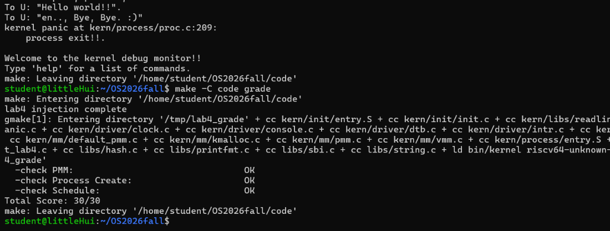

# 操作系统实验四：进程管理实验报告

> **课程**：操作系统实验（2026 秋）
> **实验名称**：Lab4 进程管理
> **小组仓库**：[fengmian-coder/OS2026fall](https://github.com/fengmian-coder/OS2026fall)
> **最终公共分支**：`lab4`；**合并提交**：`a3bcaa9741eaff8656c6e4020740752dde1e8474`
> **成员 A**：张馨月2414029（虚拟内存页操作）；**成员 B**：贾璐菡2412074（进程创建及初始化）；**成员 C**：李文慧2411785（进程调度与上下文切换，兼参与集成排查、整理报告）
> **报告日期**：2026-11-21

## 一、实验目的与任务分析

本次 Lab4 在前面物理内存、Sv39 页表、中断异常机制的基础上加入内核线程管理。按照指导书，实验可以分成三个功能模块：

1. **虚拟内存页操作**：维护物理页到虚拟地址的映射，保证页表项、引用计数和 TLB 状态一致，主要是 `page_insert()`、`page_remove()`。
2. **进程创建及初始化**：初始化 PCB、内核栈、进程链表和首次运行现场，创建 `idleproc`、`initproc`，主要是 `alloc_proc()`、`proc_init()`、`kernel_thread()`、`do_fork()`、`copy_thread()`、`copy_mm()`。
3. **进程调度**：选择可运行线程，切换当前进程、页表与寄存器上下文，主要是 `cpu_idle()`、`schedule()`、`proc_run()`、`switch_to()`。

对本实验的理解是：Lab2 主要解决“物理内存怎么管理”，Lab3 解决“出现中断或异常时怎么进入和返回内核”，Lab4 则进一步解决“多个执行实体怎样被建立、登记并轮流运行”。三个模块不是孤立的，必须能从 `kern_init` 一直执行到 `initproc`，才说明整条链路基本接通。
实验指导书规定本阶段内核线程共享内核地址空间，不等于已经实现了完整的用户进程 fork、进程退出回收、缺页按需分配或页面置换。这些功能在后续实验中继续完善。

## 二、实验环境、仓库与分工

| 项目 | 实际环境 / 内容 |
|---|---|
| 开发环境 | Windows + WSL2 Ubuntu；VS Code；Ubuntu 终端 |
| 体系结构 | RISC-V 64 位，Sv39 页表 |
| 编译工具 | `riscv64-unknown-elf-gcc`、`riscv64-unknown-elf-ld`、GNU Make 4.3 |
| 模拟器 | `qemu-system-riscv64`，OpenSBI |
| 仓库 | `git@github.com:fengmian-coder/OS2026fall.git` |
| 最终分支 | `lab4`；个人工作分支 `lab4-lwh` |
| 核心验收 | 干净编译、QEMU 启动、`make -C code grade` |

| 分工 | 主要文件 | 核心内容 |
|---|---|---|
| A：虚拟内存 | `kern/mm/pmm.c` 等 | 建立与撤销映射、维护页表和页引用计数 |
| B：进程创建 | `kern/process/proc.c` 的 function2 | PCB、内核线程创建、首次运行现场 |
| C：调度与切换 | `kern/process/proc.c` 的 function3、`kern/schedule/sched.c`、`kern/process/switch.S` | `cpu_idle`、`schedule`、`proc_run`、`switch_to` |

协作时保留 `LAB4 function1/2/3` 的原有标记和学号注释，不直接覆盖其他成员已经合并的部分。成员 A 和 B 的工作通过之前的 PR 集成，成员 C 的个人开发与修复通过 [PR #24](https://github.com/fengmian-coder/OS2026fall/pull/24) 合并。

## 三、系统整体逻辑与调用链

```text
OpenSBI / kern_entry
        |
     kern_init()
        |
    pmm_init() -------- 页操作、内存映射和分配检查（A）
        |
 pic_init / idt_init / clock_init / vmm_init
        |
    proc_init() ------- 创建 idleproc，创建 initproc（B）
        |
    cpu_idle() -------- idle 检查 need_resched（C）
        |
    schedule() -------- 遍历 proc_list 选出 PROC_RUNNABLE（C）
        |
    proc_run() -------- 更新 current；必要时切换 satp/TLB（C）
        |
    switch_to() ------- 保存旧 context，恢复新 context（C）
        |
 forkret → forkrets → __trapret
        |
 kernel_thread_entry → init_main
        |
 输出 "Hello world!!" 和结束信息
```

上半段将系统资源和线程对象准备好，下半段让线程实际获得 CPU。`schedule()` 负责“选谁”，`proc_run()` 负责“切换环境”，`switch_to()` 才是汇编层面的寄存器恢复，职责不能混在一起。

## 四、功能模块一：虚拟内存页操作（成员 A）

### 4.1 SPEC 与 Prompt 设计

**SPEC 要点**：`page_insert(pgdir,page,la,perm)` 在映射成功时返回 0，内存不足返回 `-E_NO_MEM`；要区分空映射、同一物理页重映射、替换不同物理页三种情形，不重复增加同一物理页的引用计数；`page_remove(pgdir,la)` 删除存在的映射，对未映射地址安静返回；两者都要考虑 TLB 失效。

**交互提示词整理版**：

> 请只依据当前 Lab4 工程中的 `pmm.c/pmm.h`、`struct Page`、`get_pte`、`page_ref_inc/dec` 和 `tlb_invalidate` 接口，分析 `page_insert` 与 `page_remove` 应怎样更新 PTE 和引用计数。先列出同页重映射、跨页替换、未映射删除、分配失败的边界情况，再给出符合已有接口的实现和验证步骤，不改动其他模块。

### 4.2 核心实现理解

`page_insert()` 首先定位需要修改的 PTE；如果旧映射已经指向同一物理页，就应更新权限而非重复增加引用计数；若旧映射指向其他物理页，则先正确处理旧物理页引用计数，再建立新映射。`page_remove()` 查找原 PTE，删除有效映射并在引用计数降到 0 时归还物理页。修改页表后需及时失效相应 TLB 项，否则硬件可能继续使用旧的地址翻译。

**本组验证**：集成后的 PMM 自动测试通过；该测试覆盖多地址映射、重新映射同页、替换物理页、引用计数和重复删除等情况。此处描述为模块集成结果，不替代成员 A 对最终源代码逐行核验。

## 五、功能模块二：内核线程创建与初始化（成员 B）

### 5.1 SPEC 与 Prompt 设计

**SPEC 要点**：创建 PCB 时初始化所有关键字段，失败返回 `NULL`；`proc_init()` 建立 `idleproc` 和 `initproc`；`kernel_thread`、`copy_thread` 按 `entry.S/trapentry.S` 的约定组织首次执行的 TrapFrame/Context；`do_fork()` 在成功时登记 PID 与链表、设为可运行状态，失败时回收已经申请的资源；`copy_mm()` 在 Lab4 中仅处理内核线程共享内核地址空间的约定。

**Prompt 要点（根据成员 B 已有 `memberB_prompt.md` 归纳）**：先检查 `proc.h`、内核栈分配函数和异常返回汇编，再逐个实现 function2 中的六个函数，保持 function3 不变；每次检查新代码、`git diff --check` 和编译信息，不能把链接失败归因于尚未由 C 完成的函数。

### 5.2 核心实现理解

- `alloc_proc()`：通过 `kmalloc` 申请 PCB，清零并初始化 state、pid、stack、mm、context、list/link 等字段。
- `proc_init()`：把当前内核现场包装为 `idleproc`（PID 0），再通过 `kernel_thread(init_main, ...)` 创建 `initproc`（PID 1）。
- `kernel_thread()`：把入口函数放入 `s0`、参数放入 `s1`，构造 TrapFrame 后调用 `do_fork()`。
- `copy_mm()`：Lab4 的内核线程使用共享内核地址空间，保留接口但不做完整用户地址空间复制。
- `copy_thread()`：在新线程内核栈放置 TrapFrame，设置 `context.ra = forkret` 与初始 `context.sp`，保证首次切换能走到内核线程入口。
- `do_fork()`：负责 PCB、栈、PID、全局链表和唤醒状态的衔接，并在失败时做阶段性资源清理。

成员 B 先前已在自己的报告中记录 `do_fork` 临界区和 `copy_thread` 栈指针修复；本组最终集成后 `Process Create` 测试通过。

## 六、功能模块三：调度与上下文切换（成员 C）

### 6.1 设计目标与 SPEC

我负责的四个函数如下。设计时要求不改动 B 的 `function2`，在 `function3` 标记下实现，保留学号注释。

| 函数 | 文件 | 目标 / 验收点 |
|---|---|---|
| `cpu_idle()` | `kern/process/proc.c` | 空闲线程循环检查 `current->need_resched`，需要时调用 `schedule()` |
| `schedule()` | `kern/schedule/sched.c` | 在中断保护下遍历进程链表，选择 `PROC_RUNNABLE`；无候选时退回 `idleproc` |
| `proc_run()` | `kern/process/proc.c` | 将 `current` 设置为目标线程，按需更新 `satp` 与 TLB，并调用 `switch_to()` |
| `switch_to()` | `kern/process/switch.S` | 按 RV64 ABI 保存旧线程 `ra/sp/s0~s11`，恢复新线程对应寄存器并 `ret` |

### 6.2 `cpu_idle()`：空闲线程与调度入口

最终实现的核心逻辑：

```c
void cpu_idle(void) {
    while (1) {
        if (current->need_resched) {
            schedule();
        }
    }
}
```

这是一个不断运行的空闲循环，不负责选取进程，也不直接修改 `current`。`proc_init()` 将 `idleproc->need_resched` 置为 1 后，CPU 进入 `cpu_idle()` 就会调用 `schedule()`，从而把执行权交给已经创建的 `initproc`。

### 6.3 `schedule()`：选择下一个可运行线程

在 `sched.c` 中，我保留已有的 `wakeup_proc()`，新增 `schedule()`。实现顺序为：

1. `local_intr_save(intr_flag)` 保存并关闭当前中断状态，防止调度数据结构在关键时刻被中断打断。
2. 清除 `current->need_resched`。
3. 若当前是 `idleproc`，从进程链表头开始；否则从当前进程的链表节点之后开始，沿双向链表循环查找。
4. 跳过链表头节点，只有 `state == PROC_RUNNABLE` 的进程才作为候选。
5. 如果一圈内没有找到其他可运行线程，退回 `idleproc`；更新目标线程的 `runs`，必要时调用 `proc_run(next)`。
6. `local_intr_restore(intr_flag)` 恢复进入函数前的中断状态。

与一个固定顺序的直接切换不同，这里需要考虑空链表、单线程以及多线程之间的循环边界，否则可能死循环或漏掉节点。实际调试过程中曾因 `sched.c` 末尾重复恢复中断的代码而编译失败，后来删去重复代码，并把链表遍历的边界逻辑整理成当前版本。

### 6.4 `proc_run()`：切换当前进程及运行环境

`proc_run(proc)` 首先比较 `proc` 与 `current`，目标就是当前线程时不必再执行上下文切换。否则在中断保护内保存旧进程指针 `prev`，更新 `current = proc`。在目前的最终代码中，还针对 Lab4 内核线程共享页表的特点作了判断：

```c
if (prev->pgdir != proc->pgdir) {
    write_csr(satp,
        0x8000000000000000 |
        (proc->pgdir >> RISCV_PGSHIFT));
    asm volatile("sfence.vma" ::: "memory");
}
switch_to(&(prev->context), &(proc->context));
```

其中 `satp` 记录页表模式和根页表物理页号，`sfence.vma` 使旧地址翻译缓存失效。因为 Lab4 的内核线程通常共用内核页表，不必每次线程切换都重新写入相同的 `satp`。这个条件判断属于后续集成修复中的调整；它并不表示已经实现多个独立用户地址空间。

### 6.5 `switch_to()`：RISC-V 汇编保存与恢复寄存器

`struct context` 在 `proc.h` 中依次包含 `ra`、`sp`、`s0`～`s11` 共 **14 个** `uintptr_t`，RV64 下每个 8 字节，合计 **112 字节**。`switch.S` 中 `a0` 指向旧 `context`，`a1` 指向新 `context`：

```asm
switch_to:
    # 保存旧线程的寄存器
    sd ra,   0(a0)
    sd sp,   8(a0)
    sd s0,  16(a0)
    # …… s1 ~ s10 依次每个增加 8 字节
    sd s11,104(a0)

    # 恢复新线程的寄存器
    ld ra,   0(a1)
    ld sp,   8(a1)
    ld s0,  16(a1)
    # …… s1 ~ s10 按相同偏移恢复
    ld s11,104(a1)
    ret
```

保存与恢复顺序与 C 结构体布局逐项一致。只保存 `ra/sp/s0~s11` 是因为这是一次函数调用边界上的上下文切换，调用者保存寄存器遵循 ABI 由调用代码处理；它不同于中断异常入口的完整 TrapFrame。恢复新 `ra` 后，`ret` 会回到新线程预设的继续执行位置；对于首次运行线程，后续经过 `forkret/forkrets/__trapret` 才到达 `kernel_thread_entry`。

### 6.6 我对这四个函数关系的理解

**`cpu_idle` 发现需要调度，`schedule` 选择线程，`proc_run` 设置切换环境，`switch_to` 真正恢复新线程寄存器。** 把这四个函数分开，使调度策略与底层上下文保存操作可以独立修改，也方便定位问题。

## 七、AI 辅助过程中的问题与修复

> 本节记录的是实际开发和集成排查中出现的现象。部分修复由成员C在后续联合排查中完成；这不改变 A/B/C 原有功能分工。完整 Prompt 设计及交流摘要见同目录的 `lab4_memberC_prompt.md`。

| 阶段 | 实际现象 | 排查与修复 | 验证情况 |
|---|---|---|---|
| Git 分支准备 | 从旧分支切换时未跟踪的 `report/lab3_report.md` 阻止 checkout | 先将旧报告和编译产物备份到仓库外，再建立 `lab4-lwh` | 成功切换并确认 A/B 的 PR 已合并 |
| `switch.S` 编辑 | `git diff --check` 多处 `^M`、`trailing whitespace` | 将 Windows CRLF 换行改为 Linux LF | 空白字符检查通过 |
| `proc.c` 编辑 | 报告 `new blank line at EOF` | 清除文件末尾多余空行，保留一条结尾换行 | `git diff --check` 通过 |
| `sched.c` 初步编译 | `local_intr_restore` 出现在函数结束后的重复代码中，导致编译错误 | 删除重复段、统一大括号和环形链表遍历逻辑 | 之后 `sched.c` 编译成功 |
| Makefile 与评分集成 | 部分构建变量配置不一致，且 `grade.sh/inject.py` 仍带 Lab3 逻辑 | 修正 `GCCPREFIX` 条件语句、`KINCLUDE` 追加设置，并将测试注入与评分脚本改成 Lab4 三个模块 | `lab4 injection complete`；三项测试 OK |
| 宏兼容 | `trap.c` 里 `SSTATUS_SUM` 未定义 | 对照本项目 `libs/riscv.h`，改用已有的 `SSTATUS_PUM`（对应同一状态位） | 干净编译与链接成功 |
| QEMU 启动 | 一度只出现 OpenSBI，内核不输出，伴随启动入口加载方式不匹配 | 将启动方式统一为 `-kernel $(UCOREIMG)`；重新编译运行 | 后续能输出 DTB、内存初始化和 initproc 信息 |
| QEMU 结束 | `init_main` 返回后触发 `proc.c` 的 `do_exit()` 占位 `panic`，`K>` 无限刷屏 | 没有假装已经实现完整进程退出；为当前演示环境在 `kmonitor` 入口使用 SBI 关机，避免无输入时刷屏 | QEMU 输出完成后可退出；Panic 文本仍保留 |

这里需要特别说明：`do_exit()` 在当前 Lab4 代码中仍是 `panic("process exit!!.")`，所以运行末尾出现该信息并不代表进程退出回收已完成。`sbi_shutdown()` 只是为了让模拟器结束得更可控，**不应把它写成已经实现正式的进程回收机制**。

## 八、测试方法、结果与分析

### 8.1 测试命令

在 WSL 中、项目根目录下依次执行：

```bash
cd ~/OS2026fall
make -C code clean
make -C code
make -C code qemu
make -C code grade
```

测试在最终公共 `lab4` 分支上重新执行。`make -C code` 最后出现 `+ ld bin/kernel`、`riscv64-unknown-elf-objcopy ... bin/ucore.img`，证明编译和链接成功。

### 8.2 QEMU 运行结果

QEMU 输出包含：

```text
DTB Init
memory management: default_pmm_manager
check_alloc_page() succeeded!
check_pgdir() succeeded!
check_boot_pgdir() succeeded!
kmalloc_init() succeeded!
check_vma_struct() succeeded!
check_vmm() succeeded.
++ setup timer interrupts
this initproc, pid = 1, name = "init"
To U: "Hello world!!".
To U: "en.., Bye, Bye. :)"
kernel panic at kern/process/proc.c:209:
    process exit!!.
```

从这些信息能看出初始化、内存检查和首次线程创建/切换路径已经成功运行到 `init_main`。末尾的 Panic 是 `do_exit` 占位接口触发的，属于本实验范围边界，不能把它当作系统正常退出功能的证明。


### 8.3 自动评分结果

实际执行 `make -C code grade` 后，自动注入 Lab4 测试代码并编译临时测试工程，输出：

```text
lab4 injection complete
  -check PMM:                                OK
  -check Process Create:                     OK
  -check Schedule:                           OK
Total Score: 30/30
```

| 测试项 | 覆盖内容（简述） | 结果 |
|---|---|---|
| PMM | 映射替换、引用计数、权限更新、重复删除 | OK |
| Process Create | idle/init 的 PID、状态、上下文与进程字段 | OK |
| Schedule | 创建两个测试内核线程并触发多次调度，检查线程都执行过 | OK |
| **总分** | **三个自动测试项目** | **30/30** |



上述是本组最终公共分支的实际测试结果，不是实验早期记录中的“预期通过”。

### 8.4 GitHub 协作与合并验证

成员 C 的 `lab4-lwh` 分支先提交了 `2112ba6`（主要为进程切换功能），后提交 `22eccaf`（修复编译、QEMU 和测试流程）。通过 [PR #24](https://github.com/fengmian-coder/OS2026fall/pull/24) 合并至公共 `lab4`，产生合并提交 `a3bcaa9`。之后本地执行 `git fetch` 和 `git pull --ff-only`，确认：

```text
a3bcaa9741eaff8656c6e4020740752dde1e8474  (HEAD)
a3bcaa9741eaff8656c6e4020740752dde1e8474  (origin/lab4)
```

随后在公共分支重新清理、编译并运行评分，仍得到 **30/30**，说明提交后复现的测试结果与个人分支一致。


## 九、实验涉及的重要操作系统知识

| 知识点 | 与代码的对应关系 | 我对它的理解 |
|---|---|---|
| PCB 与进程状态 | `proc_struct`、`PROC_UNINIT/RUNNABLE/...` | PCB 保存进程身份和运行信息；调度只能选合法可运行实体 |
| 虚拟内存 / 页表 | `get_pte/page_insert/page_remove/satp` | 虚拟地址不是直接物理地址；映射与页表权限由内核管理 |
| TLB | `sfence.vma` | 页表修改或地址空间变化后需处理可能过期的翻译缓存 |
| 内核栈与 TrapFrame | `copy_thread`、`forkrets` | 新线程先准备寄存器现场，再通过恢复路径进入入口函数 |
| Context 与 TrapFrame | `struct context` vs `struct trapframe` | Context 用于普通线程切换，TrapFrame 用于完整的异常返回现场，不能混淆 |
| 中断临界区 | `local_intr_save/restore` | 切换 `current`、页表和链表操作时，避免本 CPU 被中断打断导致状态不一致 |
| 调度算法 | `schedule` 的链表环形扫描 | 从就绪的候选线程中选择一个执行，没有合适的线程则退回 idle |
| ABI 与汇编 | `ra/sp/s0~s11` | 寄存器布局必须与 C 结构体一致；恢复 `ra` 决定线程继续执行的位置 |

## 十、目前没有实现或尚未覆盖的内容

本实验没有完成完整的用户态进程执行、按需分页与页面置换、用户地址空间的完整复制、完整 `do_exit`/wait 回收、以及多核环境下的真正并行调度。尽管已经通过当前 Lab4 的自动评分，也不能因此推断这些功能都被测试覆盖。

自动测试验证的是指定检查点，例如能否建立映射、创建 `initproc`、让测试线程都运行；它不能代替对所有并发情形和长期运行稳定性的检查。尤其需要进一步关注更复杂的进程退出、调度公平性和异步时钟抢占等问题。

## 十一、实验总结

通过这次 Lab4，我对“创建进程”和“让进程真正运行”之间的区别更清楚了。成员 B 的创建模块只把 PCB、栈、TrapFrame 和链表准备好；成员 C 还需要用 `schedule → proc_run → switch_to` 把执行现场切过去。调度代码看起来不长，但链表边界、中断状态、寄存器偏移和首次执行入口都有可能导致运行失败。

实验中比较有代表性的困难不是某一行语法，而是集成阶段各模块之间的配合：旧的 Lab3 评分脚本无法验证 Lab4，`SSTATUS_SUM` 宏与现有头文件不兼容，QEMU 加载方式使 OpenSBI 之后不进入内核，`do_exit()` 占位又造成 `K>` 刷屏。逐项结合源码、日志、参考代码和终端结果排查后，最终在公共 `lab4` 分支完成干净编译、QEMU 启动和三个自动测试，得到 **30/30**。

实验结束后，我认为还要在以后的实验中继续理解进程退出与资源回收，以及真正的用户进程地址空间管理。
