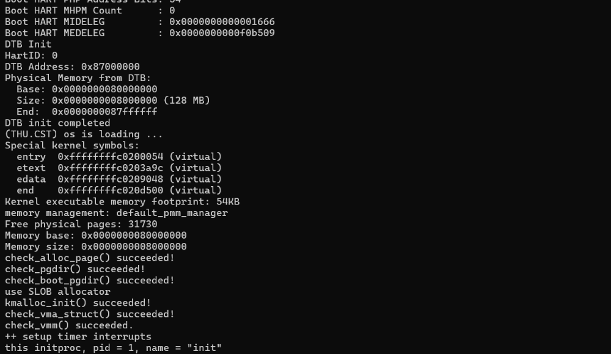
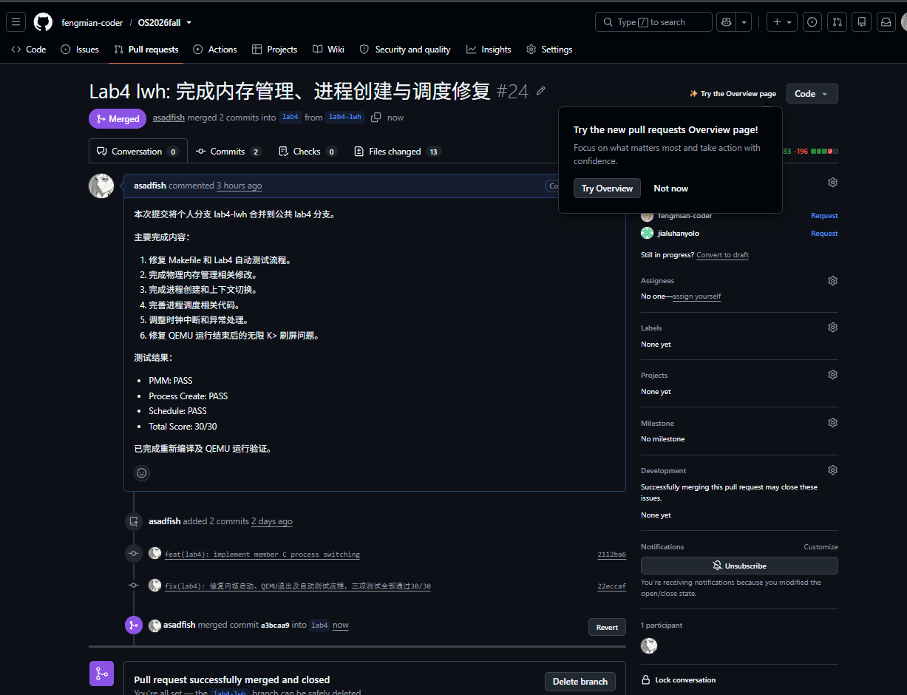

# 操作系统实验四：进程管理实验报告

> **课程**：操作系统实验（2026 秋）  
> **实验名称**：Lab4 进程管理  
> **小组仓库**：[fengmian-coder/OS2026fall](https://github.com/fengmian-coder/OS2026fall)  
> **最终集成分支**：`lab4`  
> **成员 A**：张馨月（2414029）——虚拟内存页操作与底层兼容  
> **成员 B**：贾璐菡（2412074）——进程创建与初始化  
> **成员 C**：李文慧（2411785）——进程调度与上下文切换  
> **实验时间**：2026 年 11 月 21 日

------------------------------------------------------------------------

## 一、实验目的与任务分析

本次 Lab4 在前面实验完成的物理内存管理、Sv39 页表和中断异常处理基础上，进一步实现内核线程的创建、初始化和调度。实验重点不是直接实现完整的用户进程系统，而是让内核能够创建内核线程，并通过调度和上下文切换使新线程真正运行起来。

本组按照实验指导书将任务分成三个模块：

| 成员      | 功能模块             | 主要任务                                                      | 核心函数                                                                                    |
|-----------|----------------------|---------------------------------------------------------------|---------------------------------------------------------------------------------------------|
| A：张馨月 | 虚拟内存页操作       | 建立和删除页映射，维护引用计数与 TLB，处理底层兼容            | `page_insert()`、`page_remove()`                                                            |
| B：贾璐菡 | 进程创建与初始化     | 初始化 PCB、创建 `idleproc` 和 `initproc`、准备新线程运行现场 | `alloc_proc()`、`proc_init()`、`kernel_thread()`、`do_fork()`、`copy_thread()`、`copy_mm()` |
| C：李文慧 | 进程调度与上下文切换 | 选择可运行线程，更新当前线程和页表，保存与恢复寄存器上下文    | `cpu_idle()`、`schedule()`、`proc_run()`、`switch_to()`                                     |

本次实验的整体目标是：先保证内存管理和页表操作可用，再创建线程控制块和内核栈，最后通过调度器选择线程并完成上下文切换，使 `initproc` 能够执行指定的内核线程入口函数。

需要注意，Lab4 当前阶段主要处理内核线程。内核线程共享内核地址空间，并不等于已经实现完整的用户进程地址空间复制、缺页按需分配、页面置换或完整的进程退出回收。

## 二、实验环境与整体实现逻辑

### 2.1 实验环境

| 项目     | 实际环境                            |
|----------|-------------------------------------|
| 开发系统 | Windows + WSL2 Ubuntu               |
| 编辑工具 | VS Code                             |
| 目标架构 | RISC-V 64 位                        |
| 地址转换 | Sv39                                |
| 编译工具 | `riscv64-unknown-elf-gcc`、GNU Make |
| 模拟器   | QEMU + OpenSBI                      |
| 代码仓库 | `fengmian-coder/OS2026fall`         |
| 集成分支 | `lab4`                              |

### 2.2 整体调用流程

``` text
OpenSBI
   |
kern_entry
   |
kern_init()
   |
pmm_init()                    物理内存、页表和页操作初始化（A）
   |
   +--> init_pmm_manager()
   +--> page_init()
   +--> check_alloc_page()
   +--> check_pgdir()
   +--> check_boot_pgdir()
   +--> kmalloc_init()
   |
pic_init() / idt_init()       中断控制和异常入口初始化
   |
vmm_init()                    虚拟内存管理初始化
   |
proc_init()                   创建 idleproc、initproc（B）
   |
cpu_idle()                    空闲线程检查是否需要调度（C）
   |
schedule()                    选择下一个可运行线程（C）
   |
proc_run()                    更新 current，必要时切换页表（C）
   |
switch_to()                   保存旧 context，恢复新 context（C）
   |
forkret -> forkrets -> __trapret
   |
kernel_thread_entry
   |
init_main()
   |
输出 Hello world!!
```

A 的页操作属于后续进程管理的内存基础；B 负责把新线程需要的数据准备好；C 负责让新线程获得 CPU。三个模块存在明确的依赖关系：没有可用的页管理，线程内核栈等资源就无法正常准备；没有 PCB 和初始上下文，调度器就没有可运行对象；没有调度和上下文切换，新线程即使创建成功也不能真正执行。

### 2.3 三个模块的实现顺序和关系

1.  **内存管理基础**：恢复和核对 Lab2/Lab3 中本次工程需要的物理内存初始化代码，完成页映射与删除，并检查页表及 TLB 状态。
2.  **进程创建**：分配 PCB 和内核栈，初始化 `idleproc`，通过 `kernel_thread()` 和 `do_fork()` 创建 `initproc`，准备首次运行所需的 TrapFrame 和 Context。
3.  **调度切换**：空闲线程进入 `cpu_idle()`，由 `schedule()` 选择可运行线程，再通过 `proc_run()` 和 `switch_to()` 切换执行现场。
4.  **整体集成验收**：在公共 `lab4` 分支上执行干净编译、QEMU 运行和自动评分，确认 PMM、Process Create、Schedule 三项测试结果。

## 三、功能模块一：虚拟内存页操作与底层兼容（成员 A）

### 3.1 任务分析与 SPEC

成员 A 主要负责 `code/kern/mm/pmm.c` 中的页映射和删除操作，同时检查必要的 Lab2/Lab3 内存管理代码与 Lab4 框架之间的兼容关系。

`page_insert()` 的 SPEC 主要包括：

- 通过 `get_pte(pgdir, la, 1)` 查找或创建目标虚拟地址对应的页表项。
- 如果中间页表分配失败，返回 `-E_NO_MEM`。
- 如果目标地址原来没有映射，建立新的有效映射。
- 如果原映射和新映射指向同一个物理页，只更新权限，不应让引用计数增加。
- 如果原映射指向其他物理页，应先正确撤销旧映射，再建立新映射。
- 写入新的 PTE 后，使对应 TLB 项失效。
- 成功时返回 `0`。

`page_remove()` 的 SPEC 主要包括：

- 只查找已有页表，不因删除操作而创建新的中间页表。
- 如果地址没有映射，直接安全返回。
- 如果存在有效映射，减少物理页引用计数。
- 只有引用计数降到 0 时才释放物理页。
- 清空 PTE，并使对应 TLB 项失效。

### 3.2 `page_insert()`：建立或更新页映射

该函数负责把指定物理页映射到虚拟地址 `la`，并设置权限。实现过程如下：

1.  调用 `get_pte(pgdir, la, 1)` 定位页表项；如果中间页表不存在，则尝试创建。
2.  如果返回空指针，说明页表分配失败，返回 `-E_NO_MEM`。
3.  对准备建立映射的物理页增加一次引用计数。
4.  检查原 PTE 是否有效。
5.  如果原映射和新映射指向同一物理页，则撤销刚才增加的引用计数，避免重复计数。
6.  如果原映射指向其他物理页，则先通过删除辅助函数处理旧映射。
7.  使用 `pte_create()` 写入新的物理页号和权限位。
8.  调用 `tlb_invalidate()` 使对应地址的旧 TLB 项失效。

``` c
int
page_insert(pde_t *pgdir, struct Page *page,
            uintptr_t la, uint32_t perm)
{
    pte_t *ptep = get_pte(pgdir, la, 1);

    if (ptep == NULL) {
        return -E_NO_MEM;
    }

    page_ref_inc(page);

    if (*ptep & PTE_V) {
        struct Page *old_page = pte2page(*ptep);

        if (old_page == page) {
            page_ref_dec(page);
        } else {
            page_remove_pte(pgdir, la, ptep);
        }
    }

    *ptep = pte_create(page2ppn(page), PTE_V | perm);
    tlb_invalidate(pgdir, la);

    return 0;
}
```

这里最需要注意的是“同一物理页重新映射”和“不同物理页替换”两种情况。前者不应该改变实际引用数量；后者则必须先正确减少旧物理页的引用计数，再写入新映射。

### 3.3 `page_remove_pte()`：删除有效页表项

`page_remove_pte()` 是删除映射时使用的辅助函数。它先判断 PTE 是否有效，再找到对应物理页并减少引用计数。

``` c
static void
page_remove_pte(pde_t *pgdir, uintptr_t la, pte_t *ptep)
{
    if (*ptep & PTE_V) {
        struct Page *page = pte2page(*ptep);

        page_ref_dec(page);

        if (page_ref(page) == 0) {
            free_page(page);
        }

        *ptep = 0;
        tlb_invalidate(pgdir, la);
    }
}
```

删除一个虚拟地址映射，并不代表对应物理页一定可以立即释放。因为同一个物理页可能还被其他虚拟地址引用，所以只有引用计数归零时才能调用 `free_page()`。

### 3.4 `page_remove()`：撤销指定虚拟地址映射

``` c
void
page_remove(pde_t *pgdir, uintptr_t la)
{
    pte_t *ptep = get_pte(pgdir, la, 0);

    if (ptep != NULL) {
        page_remove_pte(pgdir, la, ptep);
    }
}
```

这里第三个参数传入 `0`，表示只查询已有页表，不创建新页表。如果目标地址没有对应页表项，函数直接返回；如果存在页表项，则交给 `page_remove_pte()` 完成引用计数、物理页释放和 TLB 处理。

### 3.5 相关辅助接口

| 接口               | 作用                             |
|--------------------|----------------------------------|
| `get_pte()`        | 根据虚拟地址定位或创建对应页表项 |
| `get_page()`       | 查询虚拟地址当前映射的物理页     |
| `pte2page()`       | 根据 PTE 找到物理页描述结构      |
| `page2ppn()`       | 获取物理页对应的物理页号         |
| `page_ref_inc()`   | 增加物理页引用计数               |
| `page_ref_dec()`   | 减少物理页引用计数               |
| `free_page()`      | 释放不再被引用的物理页           |
| `pte_create()`     | 根据物理页号和权限创建 PTE       |
| `tlb_invalidate()` | 使对应虚拟地址的 TLB 项失效      |

这些函数配合完成页表修改、物理页管理和地址翻译缓存维护。

### 3.6 Lab2/Lab3 迁移与底层兼容

Lab4 使用新的工程骨架，不能直接用 Lab3 的整个 `pmm.c` 覆盖，否则可能覆盖 Lab4 已经提供的页表函数和检查代码。成员 A 根据当前工程需要，迁移并核对此前实验中的物理内存初始化内容，保留 Lab4 原有框架。

物理内存初始化主要包括：

1.  读取物理内存起始地址和大小。
2.  计算可管理的物理页范围。
3.  为 `struct Page` 描述符数组预留空间。
4.  标记内核镜像和描述符数组占用的物理页。
5.  将剩余物理页加入空闲内存管理结构。

### 3.7 `check_boot_pgdir()` 的 Sv39 高地址检查修复

在后续检查中，发现原 `check_boot_pgdir()` 使用 `int` 保存地址，而当前目标架构为 RV64，内核虚拟地址位于高半区。32 位 `int` 无法可靠保存该地址。

另外，当前启动页表使用 Sv39 的 1 GiB 叶子映射，而普通 `get_pte()` 主要按照三级页表、4 KiB 叶子项的方式查找。如果把中间级已经是叶子项的 PTE 当成下一级页表继续访问，检查方式就与当前页表结构不匹配。

修复思路是：

- 使用 `uintptr_t` 保存物理地址和虚拟地址。
- 根据高虚拟地址定位当前启动页表中的根级页表项。
- 检查该项是否有效，并具有当前启动映射所需的叶子权限。
- 根据 1 GiB 映射的物理基址和虚拟地址偏移，验证转换后的物理地址是否正确。
- 保留原有低地址映射、别名访问和释放检查。

### 3.8 成员 A 的 Prompt 设计与 AI 辅助问题

成员 A 的 Prompt 记录分为理解框架、实现页操作、解决编译错误、排查 QEMU 启动问题、检查 Sv39 页表等阶段。其设计重点是先提供老师的实验指导书和当前源码，再限定修改文件和函数，最后给出实际编译或运行日志，让 AI 根据真实错误逐步分析。

本模块遇到的主要问题如下：

| 问题                               | 原因                                                       | 处理方法                                       |
|------------------------------------|------------------------------------------------------------|------------------------------------------------|
| 找不到 `kdebug.h`                  | Makefile 的头文件搜索路径不完整                            | 检查并补充 `kern/debug/` 搜索路径              |
| `uint_t` 未定义                    | Lab4 与旧版头文件的类型定义不一致                          | 对照 Lab4 框架核对 `libs/defs.h` 等类型定义    |
| `kva2page()` 参数类型不匹配        | 调用处传入整数地址，函数接收 `void *`                      | 根据接口类型进行显式指针转换                   |
| `readline` 重复定义                | 旧版和 Lab4 新增文件同时参与链接                           | 检查源文件列表，保留当前框架对应实现           |
| `proc_init()`、`cpu_idle()` 未定义 | 开发早期 B、C 模块尚未完成                                 | 按照分工等待对应模块集成，不添加临时空实现     |
| 高地址页表检查不正确               | 32 位变量处理 RV64 高地址，且检查方式没有区分 1 GiB 叶子项 | 改用 `uintptr_t`，按当前 Sv39 启动映射结构检查 |

这一部分说明，编译通过并不代表页表逻辑一定正确。对操作系统代码还需要结合地址宽度、页表层级和物理页引用关系检查边界情况。

## 四、功能模块二：进程创建与初始化（成员 B）

### 4.1 任务分析与 SPEC

成员 B 负责 `code/kern/process/proc.c` 中 `//LAB4 function2` 对应区域，主要任务是初始化 PCB、创建内核线程，并准备线程第一次运行时所需的栈和上下文。

本模块的 SPEC 可以归纳为：

- `alloc_proc()`：申请 PCB，并将各字段初始化为安全状态；申请失败返回 `NULL`。
- `proc_init()`：初始化进程链表和 PID 哈希表，创建 `idleproc` 和 `initproc`。
- `kernel_thread()`：根据入口函数和参数准备初始 TrapFrame，并调用 `do_fork()`。
- `copy_mm()`：按照本实验内核线程共享内核地址空间的要求设置 `mm` 和 `pgdir`，不进行完整用户地址空间复制。
- `copy_thread()`：在新线程内核栈中放置 TrapFrame，设置初始 Context，使线程第一次切换后能进入 `forkret` 和异常返回路径。
- `do_fork()`：完成 PCB、内核栈、内存管理信息、线程上下文、PID 和链表登记；失败时按已申请资源逐步清理。

### 4.2 `alloc_proc()`：申请并初始化 PCB

`alloc_proc()` 使用 `kmalloc()` 为 `struct proc_struct` 分配空间。分配失败时返回 `NULL`；成功后先清零结构体，再初始化进程状态、PID、运行次数、内核栈、父进程、内存管理指针、页目录、标志位和链表节点。

PCB 是内核管理进程或线程的主要数据结构。后续调度器通过 PCB 中的状态、链表节点和 Context 等信息管理执行实体。

### 4.3 `proc_init()`：建立初始进程管理环境

`proc_init()` 首先初始化全局进程链表和 PID 哈希表，然后创建 `idleproc`：

- `idleproc` 的 PID 为 0。
- 状态设置为 `PROC_RUNNABLE`。
- 使用启动阶段已有的内核栈。
- `need_resched` 设置为 1，使进入空闲循环后能够触发调度。
- `pgdir` 指向启动内核页表。

随后调用 `kernel_thread(init_main, "Hello world!!", 0)` 创建第一个普通内核线程，并通过 PID 找到对应 PCB，设置为 `initproc`。

### 4.4 `kernel_thread()`：准备内核线程入口

该函数根据传入的函数指针和参数构造临时 TrapFrame：

- 将线程入口函数放入约定的寄存器位置。
- 将参数放入约定的寄存器位置。
- 设置 `epc` 指向 `kernel_thread_entry`。
- 设置状态寄存器，使新线程从预期的 Supervisor 模式返回。
- 调用 `do_fork()` 创建线程。

因此，`kernel_thread()` 不是直接让函数立即执行，而是先构造好新线程第一次运行时需要恢复的现场。

### 4.5 `copy_mm()`：设置内核线程地址空间

当前 Lab4 的内核线程共享内核地址空间，因此 `copy_mm()` 不需要像完整用户进程 `fork()` 那样复制用户页表。

在当前实现中，线程的 `mm` 保持为 `NULL`，`pgdir` 使用启动内核页表的物理地址。这个处理符合本次内核线程实验范围，但不能据此认为已经实现不同用户进程之间的地址空间隔离。

### 4.6 `copy_thread()`：准备首次运行现场

`copy_thread()` 在新线程内核栈顶部放置 TrapFrame，并复制传入的初始寄存器现场。随后设置新线程首次运行时的返回值和栈指针，并建立 Context：

- `context.ra` 指向 `forkret`。
- `context.sp` 指向新线程的 TrapFrame。
- TrapFrame 中的栈指针指向新线程可用的内核栈位置。

第一次上下文切换恢复这个 Context 后，会进入 `forkret`，再经过 `forkrets` 和 `__trapret` 恢复 TrapFrame，最后进入 `kernel_thread_entry` 执行线程入口。

### 4.7 `do_fork()`：完成线程创建和登记

`do_fork()` 把前面的初始化步骤连接起来，主要顺序如下：

``` text
检查进程数量上限
       |
alloc_proc()             分配 PCB
       |
setup_kstack()           分配内核栈
       |
copy_mm()                设置地址空间
       |
copy_thread()            准备 TrapFrame 和 Context
       |
get_pid()                分配 PID
       |
hash_proc()              加入 PID 哈希表
       |
list_add()               加入进程链表
       |
wakeup_proc()            设置为可运行状态
       |
返回 PID
```

如果中间步骤失败，需要根据已经申请的资源执行对应清理，避免留下未登记完整的 PCB 或内核栈资源。PID 分配和进程链表、哈希表更新需要在中断保护范围内完成，避免关键数据结构更新过程中被打断。

### 4.8 成员 B 的 Prompt 设计与关键修正

成员 B 的 Prompt 设计围绕 `proc.h` 中的 PCB/Context 定义、`proc.c` 中的辅助函数、内核栈分配接口和异常返回汇编展开。提示词需要明确：

1.  当前只实现 `function2`，不修改成员 C 的 `function3`。
2.  先检查已有字段和函数接口，再逐个实现六个函数。
3.  对 PCB 初始化、资源分配、失败回滚、PID/链表登记和首次运行现场分别提出要求。
4.  每次修改后检查差异、编译结果和运行结果，不把尚未实现的 C 模块函数当成 B 模块错误。

在实现过程中，重点核对了两个容易出错的地方：

- **`do_fork()` 的临界区**：PID 分配和进程链表、哈希表更新需要受到中断保护，避免更新过程被打断。
- **`copy_thread()` 的初始栈和 Context**：TrapFrame 应放在新线程内核栈的合适位置，`context.ra` 和 `context.sp` 必须能接上首次运行路径，否则线程切换后可能无法正确进入 `forkret`。

## 五、功能模块三：进程调度与上下文切换（成员 C）

### 5.1 任务分析与 SPEC

成员 C 负责以下四个函数：

| 函数          | 文件                         | SPEC                                                                     |
|---------------|------------------------------|--------------------------------------------------------------------------|
| `cpu_idle()`  | `code/kern/process/proc.c`   | 空闲线程持续运行，检查 `need_resched`，需要时调用 `schedule()`           |
| `schedule()`  | `code/kern/schedule/sched.c` | 遍历进程链表，选择 `PROC_RUNNABLE` 线程；没有其他候选时回退到 `idleproc` |
| `proc_run()`  | `code/kern/process/proc.c`   | 更新 `current`，必要时切换页表和刷新 TLB，再调用 `switch_to()`           |
| `switch_to()` | `code/kern/process/switch.S` | 保存旧线程 Context，恢复新线程 Context 中的寄存器                        |

本模块的主要难点是 C 语言调度逻辑与 RISC-V 汇编上下文切换之间的配合。调度器负责决定运行哪个线程，汇编函数负责保存和恢复寄存器。

### 5.2 `cpu_idle()`：空闲线程循环

``` c
void
cpu_idle(void)
{
    while (1) {
        if (current->need_resched) {
            schedule();
        }
    }
}
```

`cpu_idle()` 是空闲线程的运行入口。它不会自己挑选下一个线程，也不负责保存寄存器，而是持续检查当前线程是否需要重新调度。如果 `need_resched` 被设置，就调用 `schedule()`。

空闲线程不能像普通函数一样执行完后直接返回，因为当系统没有其他可运行线程时，它需要继续作为后备执行实体等待调度。

### 5.3 `schedule()`：选择下一个可运行线程

`schedule()` 在 `sched.c` 中实现，主要步骤如下：

1.  使用 `local_intr_save(intr_flag)` 保存并关闭当前中断状态，保护调度过程中的关键数据。
2.  清除当前线程的 `need_resched` 标志。
3.  根据当前线程在 `proc_list` 中的位置开始遍历链表。
4.  跳过链表头节点，检查候选线程的状态。
5.  只有状态为 `PROC_RUNNABLE` 的线程才可以作为运行候选。
6.  如果没有找到其他可运行线程，则选择 `idleproc`。
7.  更新选中线程的运行次数，必要时调用 `proc_run(next)`。
8.  使用 `local_intr_restore(intr_flag)` 恢复进入函数前的中断状态。

这里要注意链表的循环边界。调度器需要能够处理只有一个线程、链表为空或当前线程已经位于链表末尾等情况，否则容易出现漏选或循环错误。

实验指导书中对调度策略出现 FIFO 和 Round-Robin 的表述。当前实现按照进程链表进行轮转扫描，但不能把它夸大成已经实现了完整的时间片抢占式调度。是否发生抢占还取决于定时器中断和相应的调度触发机制。

### 5.4 `proc_run()`：切换当前线程和运行环境

`proc_run(proc)` 负责切换到指定线程。若目标线程就是当前线程，则不需要重复切换。

如果目标不同，主要过程是：

1.  保存原来的 `current`，作为旧线程 `prev`。
2.  进入中断保护区。
3.  更新全局 `current` 指针。
4.  比较旧线程和新线程的 `pgdir`。
5.  如果页目录不同，则更新 RISC-V `satp`，并执行 `sfence.vma` 刷新地址翻译缓存。
6.  调用 `switch_to(&prev->context, &proc->context)` 保存旧 Context 并恢复新 Context。
7.  当旧线程以后再次被调度恢复执行时，继续完成对应的中断状态恢复。

Lab4 的内核线程通常共享内核页表，因此不需要在每次线程切换时都重复写入相同的 `satp`。页表切换条件判断并不表示本实验已经实现多个独立用户地址空间。

### 5.5 `switch_to()`：RISC-V 汇编上下文切换

`struct context` 中依次保存 `ra`、`sp`、`s0` 到 `s11`，合计 14 个 64 位寄存器。每个寄存器占 8 字节，因此结构体所需空间为 112 字节。

`switch_to(from, to)` 中，`a0` 指向旧线程 Context，`a1` 指向新线程 Context。汇编函数先将当前线程的寄存器保存到 `from`，再从 `to` 中恢复新线程寄存器，最后通过 `ret` 跳转到新线程保存的返回地址。

| 寄存器 | 偏移 |
|--------|-----:|
| `ra`   |    0 |
| `sp`   |    8 |
| `s0`   |   16 |
| `s1`   |   24 |
| `s2`   |   32 |
| `s3`   |   40 |
| `s4`   |   48 |
| `s5`   |   56 |
| `s6`   |   64 |
| `s7`   |   72 |
| `s8`   |   80 |
| `s9`   |   88 |
| `s10`  |   96 |
| `s11`  |  104 |

这里保存的是普通函数调用边界上的线程 Context，不是中断异常入口保存的完整 TrapFrame。调用者保存寄存器由 ABI 约定和调用代码负责处理，因此不能把 Lab3 的完整 TrapFrame 保存方式直接照搬到这里。

### 5.6 四个函数之间的关系

可以用一句话概括：

**`cpu_idle()` 发现需要调度，`schedule()` 选择线程，`proc_run()` 准备切换环境，`switch_to()` 真正保存和恢复 CPU 寄存器上下文。**

这四个函数分层完成不同任务，便于将调度策略和底层寄存器切换分开理解和调试。

### 5.7 成员 C 的 Prompt 设计与 AI 辅助问题

成员 C 的开发过程先检查 `proc.h`、`proc.c`、`sched.c`、`switch.S` 和中断保护接口，再按 `switch_to()`、`proc_run()`、`schedule()`、`cpu_idle()` 的顺序逐步实现。Prompt 主要要求 AI：

- 先核对当前仓库的真实结构体和函数接口，不直接套用其他版本代码。
- 只修改 `function3` 和 C 负责的两个独立文件，不覆盖 B 的 `function2`。
- 对照 `struct context` 的寄存器顺序核对汇编偏移。
- 检查中断保护、页表切换和链表遍历逻辑。
- 每完成一部分就使用 `git diff --check`、编译和 QEMU 结果验证。

开发和集成过程中出现的问题及处理方式如下：

| 问题                       | 原因                                           | 处理方式                                                                |
|----------------------------|------------------------------------------------|-------------------------------------------------------------------------|
| 切换分支失败               | 工作区中未跟踪的 Lab3 报告会被目标分支文件覆盖 | 先备份旧报告和编译目录，再切换分支                                      |
| `^M` 和行尾空白            | Windows 与 Linux 换行格式不同，编辑时留下空白  | 统一换行格式，重新执行 `git diff --check`                               |
| `sched.c` 编译失败         | 函数外出现重复的中断恢复代码，括号结构不正确   | 删除重复代码，检查函数边界和链表遍历                                    |
| `SSTATUS_SUM` 未定义       | 当前工程头文件没有该宏                         | 对照 `libs/riscv.h`，使用工程中已有且对应相同状态位的宏                 |
| QEMU 只显示 OpenSBI        | 内核镜像加载方式与当前工程启动配置不匹配       | 核对 Makefile 和镜像加载参数，统一使用 `-kernel $(UCOREIMG)` 后重新运行 |
| Lab3 评分脚本不能验证 Lab4 | 测试注入脚本和评分入口仍保留旧实验逻辑         | 将测试注入与评分脚本调整为 Lab4 的三个模块                              |
| `do_exit()` 触发 Panic     | 当前实验中的进程退出接口仍是占位实现           | 如实记录为实验范围边界，不把它说成已经实现完整进程退出回收              |

## 六、AI 辅助开发中的问题分析与处理

本次实验使用 AI 辅助阅读代码、分析函数接口、整理实现思路和定位错误。AI 给出的代码或修改建议都结合了当前工程实际情况进行检查，没有只因为代码能够编译就认为功能一定正确。

| 模块 | 典型问题                                                               | 解决方式                                                                |
|------|------------------------------------------------------------------------|-------------------------------------------------------------------------|
| A    | 头文件搜索路径、类型定义和指针参数不兼容                               | 根据编译器报错定位文件，比较 Lab4 原始框架和当前代码，逐项修复          |
| A    | `readline` 重复定义、B/C 函数尚未实现导致链接失败                      | 检查参与编译的源文件；按小组分工等待对应模块完成                        |
| A    | RV64 高地址被 32 位变量处理，普通页表查询方式不适合当前 1 GiB 叶子映射 | 使用 `uintptr_t`，按照当前 Sv39 启动页表结构进行检查                    |
| B    | `do_fork()` 中 PID 和链表登记需要保护                                  | 使用中断保护包围关键数据结构更新                                        |
| B    | 新线程首次运行时栈和返回路径不正确会导致无法进入线程入口               | 核对 TrapFrame 位置、`context.ra` 和 `context.sp`，确保连接到 `forkret` |
| C    | 调度代码中断保护和链表遍历边界容易出错                                 | 先检查链表接口，再逐步实现并编译验证                                    |
| C    | Context 汇编偏移可能与 C 结构体不一致                                  | 按 `proc.h` 中字段顺序逐项核对 14 个寄存器偏移                          |
| 集成 | QEMU 启动方式、旧评分脚本和头文件宏不匹配                              | 结合 Makefile、头文件和实际终端输出进行最小范围修复                     |

AI 辅助开发的流程是：先提供上下文和真实代码，再明确修改范围和功能要求，随后让 AI 分析错误日志，最后通过编译、运行和测试验证。不把 AI 的推测直接当成已经确认的故障原因。

## 七、实验测试与结果分析

### 7.1 测试命令

在仓库根目录执行：

``` bash
make -C code clean
make -C code
make -C code qemu
make -C code grade
```

其中，`make clean` 用于清理旧编译产物；`make` 用于重新编译和链接；`make qemu` 用于观察内核启动和线程执行过程；`make grade` 用于运行 Lab4 自动评分测试。

### 7.2 QEMU 运行结果

集成后的 QEMU 输出包含以下关键内容：

``` text
check_alloc_page() succeeded!
check_pgdir() succeeded!
check_boot_pgdir() succeeded!
kmalloc_init() succeeded!
check_vma_struct() succeeded!
check_vmm() succeeded.

this initproc, pid = 1, name = "init"
To U: "Hello world!!".
To U: "en.., Bye, Bye. :)"
```

这些输出说明物理内存管理、页表检查和虚拟内存初始化已经完成，`initproc` 已经创建，并且首次运行路径能够进入 `init_main()` 执行指定代码。

当前实验中的 `do_exit()` 仍然是未完成的占位接口。如果 QEMU 在上述输出之后出现 `process exit!!` 相关 Panic，应将其理解为线程入口函数返回后进入了尚未实现的退出处理路径，而不能把它说成已经完成了正式的进程退出和资源回收。

<figure>

<figcaption aria-hidden="true">图1：QEMU 启动及内核输出</figcaption>
</figure>

### 7.3 自动评分结果

执行：

``` bash
make -C code grade
```

最终集成测试输出：

``` text
lab4 injection complete
  -check PMM:             OK
  -check Process Create:  OK
  -check Schedule:        OK

Total Score: 30/30
```

| 测试项目       | 主要检查内容                                   | 结果      |
|----------------|------------------------------------------------|-----------|
| PMM            | 页映射、映射替换、引用计数、权限更新和重复删除 | OK        |
| Process Create | PCB 初始化、进程创建和首次运行现场             | OK        |
| Schedule       | 可运行线程选择和上下文切换                     | OK        |
| **总分**       | **三个自动测试项目**                           | **30/30** |

<figure>

<figcaption aria-hidden="true">图2：Lab4 自动评分结果</figcaption>
</figure>

该结果来自小组在集成后的 `lab4` 分支上实际执行的自动评分。自动评分覆盖的是脚本规定的测试点。

### 7.4 Git 集成情况

小组使用独立分支完成各自模块，再将代码合并到公共 `lab4` 分支。成员 A、B、C 的主要代码分别通过对应的分支和 PR 集成。最终在公共分支重新执行编译、QEMU 和评分测试，结果保持为 30/30。

<figure>

<figcaption aria-hidden="true">图3：Lab4 分支或 PR 合并记录</figcaption>
</figure>

## 八、实验涉及的重要操作系统知识点及其关系

| 知识点             | 实验中的对应内容                              | 含义、联系与区别                                                                                    |
|--------------------|-----------------------------------------------|-----------------------------------------------------------------------------------------------------|
| 物理内存管理       | `page_init()`、`alloc_pages()`、`free_page()` | 管理真实物理页，决定哪些物理页可分配；它本身不决定程序使用的虚拟地址                                |
| 虚拟内存管理       | `get_pte()`、`page_insert()`、`page_remove()` | 管理虚拟地址到物理地址的映射关系，建立在物理页管理基础上                                            |
| 页表与 PTE         | Sv39 多级页表、`pte_t`                        | 页表由多级页表项组成；PTE 是其中一个具体表项，保存物理页号和权限等信息                              |
| 物理页引用计数     | `page_ref_inc()`、`page_ref_dec()`            | 记录物理页被多少个映射引用；引用计数归零后才可以释放物理页                                          |
| TLB                | `tlb_invalidate()`、`sfence.vma`              | TLB 缓存近期地址转换结果；页表改变后需要处理旧缓存，页表与 TLB 不是同一个东西                       |
| `satp`             | `proc_run()`                                  | RISC-V 的 `satp` 保存地址转换模式和页表根页号；切换地址空间时需要更新它                             |
| PCB                | `struct proc_struct`                          | 保存进程或线程的状态、PID、内核栈、页目录和上下文等管理信息                                         |
| Context            | `struct context`、`switch_to()`               | 保存普通线程切换需要的寄存器现场，主要用于函数调用边界上的上下文切换                                |
| TrapFrame          | `struct trapframe`、`__trapret`               | 保存异常或中断返回需要恢复的完整寄存器现场；与普通线程 Context 的用途不同                           |
| 内核栈             | `setup_kstack()`、`copy_thread()`             | 每个线程执行内核代码时使用的栈；新线程需要先准备好自己的内核栈和初始现场                            |
| 进程状态           | `PROC_UNINIT`、`PROC_RUNNABLE` 等             | 描述进程所处阶段；本实验中 `PROC_RUNNABLE` 表示可运行状态，在当前简单实现里不单独区分正在运行的状态 |
| `need_resched`     | `cpu_idle()`、`schedule()`                    | 表示当前线程需要重新调度的标志，不是进程链表，也不是调度算法本身                                    |
| 调度与上下文切换   | `schedule()`、`proc_run()`、`switch_to()`     | 调度决定运行哪个线程；上下文切换负责保存旧线程并恢复新线程的执行现场                                |
| 中断保护           | `local_intr_save()`、`local_intr_restore()`   | 保护关键操作不被本 CPU 的中断打断；它不等同于多核环境下的自旋锁                                     |
| 内核线程与用户进程 | `kernel_thread()`、`copy_mm()`                | 内核线程在内核态执行并共享内核地址空间；完整用户进程还需要用户地址空间和用户态执行环境              |
| 首次运行路径       | `forkret`、`forkrets`、`__trapret`            | 将新线程预先准备好的 Context 和 TrapFrame 接起来，使第一次调度后能够进入线程入口函数                |

其中需要特别区分以下几组概念：

1.  **物理内存分配与虚拟内存映射**：分配决定使用哪一页真实物理内存；映射决定虚拟地址最终对应哪一页物理内存。两者相互配合，但功能不同。
2.  **页表与 TLB**：页表保存地址映射的正式结构；TLB 是处理器用于加速地址转换的缓存。修改页表后，如果不处理旧 TLB 项，处理器可能继续使用过期的转换结果。
3.  **Context 与 TrapFrame**：Context 用于线程之间的普通切换；TrapFrame 用于中断或异常发生后保存和恢复处理器现场。二者保存的内容和使用场景不同。
4.  **调度与上下文切换**：调度器决定下一个运行对象；上下文切换负责真正切换寄存器和执行位置。
5.  **中断关闭与锁**：关闭本地中断可以防止当前 CPU 在临界区被中断打断，但不能代替多核系统中用于跨 CPU 互斥的锁。
6.  **内核线程与完整用户进程**：本次实验创建的是共享内核地址空间的内核线程，并没有完成完整用户进程的地址空间复制和用户态隔离。

## 九、重要但本实验尚未实现的操作系统原理

本次 Lab4 完成了基本页操作、内核线程创建和调度切换，但仍有一些重要机制没有在当前实验中完整实现。

1.  **按需分页（Demand Paging）**：程序访问某个虚拟页时才分配物理页，而不是提前把所有需要的页面都建立好映射。
2.  **缺页异常处理（Page Fault Handling）**：访问未映射或权限不允许的页面时，内核需要根据异常原因决定分配页面、加载数据或终止进程。
3.  **页面置换（Page Replacement）**：物理内存不足时，需要根据 FIFO、LRU 等策略选择页面换出。
4.  **交换空间（Swap）**：将暂时不使用的页面保存到外部存储，需要时再读回内存。
5.  **写时复制（COW）**：多个进程先共享物理页，发生写操作时再复制页面，以减少进程创建时的内存复制开销。
6.  **完整用户进程地址空间**：不同用户进程需要具有独立的地址空间，并建立用户态与内核态的访问权限隔离。
7.  **完整进程退出与资源回收**：需要实现退出状态保存、父子进程关系处理、等待机制以及内核栈和页表等资源回收。本次 `do_exit()` 仍为占位实现，不能视为已经完成。
8.  **多核调度与同步**：多核环境下需要考虑多个 CPU 同时访问进程链表、运行队列和共享数据结构的问题，通常需要自旋锁等同步机制。
9.  **完整的抢占式时间片调度**：需要结合定时器中断、时间片管理和调度触发机制。本次链表轮转扫描不等于已经实现完整的抢占式调度系统。

这些内容都是操作系统中重要的知识点，但超出了本次 Lab4 当前实现和自动评分覆盖的范围。

## 十、实验总结

通过本次实验，我们把前面实验中的内存管理、页表和中断异常处理基础，与内核线程的创建和调度连接起来。

成员 A 完成页映射、映射删除、引用计数和 TLB 维护，并处理了 Lab2/Lab3 与 Lab4 工程之间的兼容问题；成员 B 完成 PCB 初始化、内核线程创建、内核栈和首次运行现场准备；成员 C 完成空闲线程循环、调度器、当前线程切换以及 RISC-V 汇编上下文保存与恢复。

本次实验中比较重要的认识是：创建线程和运行线程是两个不同阶段。创建阶段需要准备 PCB、内核栈、TrapFrame 和 Context；运行阶段则需要调度器选出线程，再由 `proc_run()` 和 `switch_to()` 完成执行环境切换。

实验也说明，操作系统代码的调试不能只依赖编译器是否报错。页表层级、地址宽度、引用计数、中断保护、链表边界和寄存器偏移都可能影响最终运行结果。AI 可以帮助分析代码和错误日志，但最后我们依然通过实际编译、QEMU 运行和自动测试确认。

最终，小组在集成后的 `lab4` 分支完成编译、QEMU 运行和自动评分，PMM、Process Create、Schedule 三项测试均通过，得到 **30/30**。同时，我们也明确了当前实验尚未实现完整用户进程、按需分页、页面置换和进程退出回收等功能，避免把实验范围之外的机制写成已经完成。

## 十一、扩展练习 Challenge

本节根据 Lab4 实验指导书中的扩展练习与 `get_pte()` 思考题整理，代码位置均相对于项目的 `code/` 目录。

### 11.1 `local_intr_save` 与 `local_intr_restore` 如何实现中断保护？

**答：** `local_intr_save(intr_flag)` 调用 `__intr_save()` 检查 `sstatus.SIE`。若当前 CPU 的 S 模式中断原本开启，则先关闭中断，并把原状态记为 `1`；若原本关闭，则记为 `0`。关键操作结束后，`local_intr_restore(intr_flag)` 通过 `__intr_restore()` 只在原来开启中断时重新打开中断，因此可以正确恢复进入临界区前的状态。

例如外层临界区关中断后，内层再次调用 `local_intr_save` 会记录 `0`；内层退出不会提前打开中断，外层退出才恢复原来的开启状态。这种方式保护**当前 CPU** 上的关键操作，不能替代多核系统中的互斥锁，也不会屏蔽非法指令、页故障等同步异常。

**代码位置：** `kern/sync/sync.h`：`__intr_save()`、`__intr_restore()`、`local_intr_save`、`local_intr_restore`；`kern/schedule/sched.c`：`schedule()`；`kern/process/proc.c`：`do_fork()`、`proc_run()`。

### 11.2 Sv32、Sv39、Sv48 分页模式有什么区别？

**答：** 三者都使用多级页表进行虚拟地址到物理地址的转换，主要区别是有效虚拟地址位数和页表层数。本实验运行在 RV64 上，使用 **Sv39 三级页表**，普通页大小为 4 KiB。

| 分页模式 | 有效虚拟地址位数 | 页表层数 | 普通页地址划分 |
|---|---:|---:|---|
| Sv32 | 32 位 | 2 级 | 10 位索引 + 10 位索引 + 12 位偏移 |
| Sv39 | 39 位 | 3 级 | 9 + 9 + 9 位索引 + 12 位偏移 |
| Sv48 | 48 位 | 4 级 | 9 + 9 + 9 + 9 位索引 + 12 位偏移 |

Sv39 每张页表有 512 项，每项 8 字节，正好占一个 4 KiB 物理页。普通 4 KiB 映射需要查到最末级 PTE；如果上级页表项已经是合法叶子项，还可能形成 2 MiB 或 1 GiB 的大页映射。本项目启动映射中使用了 Sv39 的 1 GiB 叶子项。

**代码位置：** `kern/mm/mmu.h`：`PDX1`、`PDX0`、`PTX`、`PGSIZE` 和 PTE 标志位；`kern/init/entry.S`：启动页表和 `satp` 设置；`kern/mm/pmm.c`：`check_boot_pgdir()`。

### 11.3 为什么 `get_pte()` 中有两段形式相似的代码？

**答：** `get_pte()` 要从 Sv39 根页表找到某个虚拟地址对应的末级页表项，因此需要先后经过两级中间页表。这两段代码分别按照 `PDX1(la)`、`PDX0(la)` 查找中间页表项；如果该项无效，并且 `create=1`，就申请一页内存作为下一级页表、清零并建立连接。两级处理步骤相同，因此代码形式相似。完成两级查找后，再通过 `PTX(la)` 返回末级 PTE 的地址。

**代码位置：** `kern/mm/pmm.c`：`get_pte(pde_t *pgdir, uintptr_t la, bool create)`。

### 11.4 `get_pte()` 将查询和页表分配合在一起好吗？有必要拆开吗？

**答：** 这种设计有优点：同一个函数通过 `create` 参数同时支持纯查询和按需建立中间页表，避免重复写多级页表遍历逻辑。`create=0` 时只查询；`create=1` 时允许申请缺少的中间页表。

缺点是创建过程中可能出现部分分配成功、后续分配失败的情况。如果没有回滚逻辑，就可能遗留无用的页表页。将查询与创建分开可以明确区分只读操作和资源分配操作，使错误处理更容易维护；但也会带来接口或实现上的重复。因此**不一定必须拆开，关键是创建失败时保持页表结构和物理页资源一致**。

针对本次发现的实际边界情况，我们修复了 `get_pte()` 在第二次中间页表申请失败时的回滚，并进行了下述故障注入专项测试。

**代码位置：** `kern/mm/pmm.c`：`get_pte()`、`page_insert()`。

---

## 十二、`get_pte()` 分配失败回滚修复与实测验证

### 12.1 问题发现与修复目标

原先的 `get_pte()` 在 `create=1` 时可能需要连续分配两张中间页表。如果第一次申请成功、第二次申请失败，函数虽然返回 `NULL`，但第一次新建的页表连接和物理页可能仍然保留，形成资源泄漏。

本次修复针对该情况：记录**本次调用新分配的第一级中间页表页**；当后续页表页申请失败时，撤销对应的根页表项，并释放此次新分配的页表页。若第一级页表原本就存在，则不能误删原有页表。`page_insert()` 接收到 `get_pte()` 的失败结果后返回 `-E_NO_MEM`。

**代码位置：** `kern/mm/pmm.c`：`get_pte()`、`page_insert()`；物理页释放接口 `free_page()`。

### 12.2 专项测试设计

为实际验证回滚分支，采用**故障注入（Fault Injection）**。测试使用独立的临时根页表，通过临时测试开关人为使第一次中间页表申请成功、第二次申请返回 `NULL`，然后用断言检查：

1. 故障注入是否确实触发；
2. `page_insert()` 是否返回 `-E_NO_MEM`；
3. 本次新建的根页表项是否恢复为 `0`；
4. 目标数据页的引用计数是否仍为 `0`；
5. 操作前后空闲物理页数量是否一致。

**测试相关代码位置：** `kern/mm/pmm.c`：临时故障注入开关、`alloc_pages()` 中的注入判断、`check_pte_oom_rollback()` 和 `pmm_init()` 中的条件测试调用。正式版本关闭故障注入开关。

### 12.3 故障注入的实际运行结果

在 WSL 环境下执行以下命令，完成重新编译和 QEMU 运行：

```bash
make -C code clean
make -C code
make -C code qemu
```

QEMU 实际输出：

```text
[OOM] injected allocation failure
[Test PTE OOM] ret=-4, root=0x0, before=31728, after=31728
[Test PTE Rollback] PASS
```

**结果分析：**

- `[OOM] injected allocation failure` 表明测试指定的申请失败实际发生。
- `ret=-4` 对应本项目的 `-E_NO_MEM`，说明插入映射正确报告内存不足。
- `root=0x0` 表明新建的根页表连接被撤销。
- `before=31728, after=31728` 表明该测试路径的空闲物理页数量未减少；目标数据页引用计数保持为 `0` 的断言也已通过。
- `[Test PTE Rollback] PASS` 表明本次专项测试的全部断言执行通过。

**专项测试结论：** 在“第一次中间页表分配成功、第二次分配失败”的实际注入场景下，回滚操作通过测试，未发现遗留的页表连接或物理页数量损失。

### 12.4 关闭故障注入后的正式回归测试

完成专项测试后，关闭 `LAB4_TEST_OOM` 开关，重新执行：

```bash
make -C code clean
make -C code
make -C code qemu
make -C code grade
```

正式 QEMU 输出中未再出现 `[OOM] injected allocation failure`，且依次出现：

```text
check_alloc_page() succeeded!
check_pgdir() succeeded!
check_boot_pgdir() succeeded!
kmalloc_init() succeeded!
check_vma_struct() succeeded!
check_vmm() succeeded.
this initproc, pid = 1, name = "init"
To U: "Hello world!!".
To U: "en.., Bye, Bye. :)"
```

正式自动评分的实际输出为：

```text
  -check PMM:                                OK
  -check Process Create:                     OK
  -check Schedule:                           OK
Total Score: 30/30
```

**回归测试结论：** 关闭故障注入后，内核能够完成编译、启动及既有初始化检查，Lab4 自动评分三项检查均为 `OK`，最终得分 **30/30**。因此，本次修改没有破坏上述已覆盖的物理内存页操作、内核线程创建和调度测试。

> 注：QEMU 末尾 `process exit!!.` 的 Panic 来自 Lab4 中尚未实现完整退出回收的 `do_exit()` 占位代码，并非此次回滚测试失败；其含义应与实际的退出资源回收功能区分。

### 12.5 本次修复总结

本次工作不仅修复了 `get_pte()` 在指定分配失败路径下的资源回滚问题，还通过**主动触发失败路径的专项测试**与**关闭故障注入后的正式回归测试**分别验证修复效果和原有功能。两轮测试的原始输出均已记录。