# Lab2 物理内存管理实验报告

## 1. 物理内存初始化与 First-Fit


### 一、实验任务与目标

本部分主要负责 uCore 操作系统的物理内存初始化，并理解 First-Fit 物理页分配算法的实现原理。

主要工作包括：

1. 阅读物理内存管理相关代码，理解 `struct Page` 和 `pmm_manager` 的作用。
2. 在 `kern/mm/pmm.c` 中实现 `page_init()` 函数。
3. 根据设备树（DTB）获取物理内存的起始地址和容量。
4. 初始化物理页描述符数组，区分内核占用区域与可分配区域。
5. 调用 `init_memmap()`，将可用物理页交给页面分配器管理。
6. 理解 First-Fit 算法的分配、释放与空闲块管理过程，并进行运行验证。

### 二、物理内存初始化的整体流程

uCore 启动后，首先由 OpenSBI 将控制权交给内核。内核完成基本启动配置后，调用 `pmm_init()` 初始化物理内存管理系统。

本实验涉及的主要流程为：

`OpenSBI → kern_entry → kern_init() → pmm_init() → page_init() → init_memmap()`

其中，`page_init()` 负责确定物理内存范围、建立物理页描述符数组以及初始化可分配的物理页区域。

具体实现过程如下：

1. 通过 `get_memory_base()` 和 `get_memory_size()` 获取物理内存信息。
2. 设置内核虚拟地址与物理地址之间的偏移量 `va_pa_offset`。
3. 计算物理页号上界 `npage`。
4. 根据内核结束符号 `end` 确定 `pages` 数组的存放位置。
5. 为每个物理页初始化 `Page` 描述符，并将其标记为保留页。
6. 计算 `Page` 数组之后的第一个可用物理页地址。
7. 调用 `init_memmap()` 将空闲物理页交给页面分配器管理。

通过上述流程，系统可以从启动时已知的物理内存范围中确定可用页面，为后续页分配与释放操作提供基础。

### 三、page_init() 的设计与实现

#### 3.1 物理内存信息获取

首先通过 `get_memory_base()` 和 `get_memory_size()` 获取设备树中记录的物理内存起始地址及容量，并使用 `assert()` 检查内存范围是否合法。

实验中 QEMU 模拟的物理内存信息为：

- 物理内存起始地址：`0x80000000`
- 物理内存大小：128 MB
- 物理内存结束地址（不包含）：`0x88000000`

#### 3.2 关键变量与物理内存布局

`page_init()` 中的重要变量及作用如下：

| 变量 | 作用 |
|---|---|
| `end` | 链接脚本定义的内核结束位置，用于确定后续可存放页描述符的空间 |
| `pages` | 指向物理页描述符数组的起始地址 |
| `npage` | 物理页号上界，用于确定物理页编号范围 |
| `nbase` | 物理内存起始页号，用于计算 `pages` 数组下标 |
| `va_pa_offset` | 内核虚拟地址与物理地址之间的偏移量 |
| `freemem` | `Page` 数组之后第一个页对齐的可用虚拟地址 |

实现中，首先设置：

```c
va_pa_offset = PHYSICAL_MEMORY_OFFSET;
npage = (mem_base + mem_size) / PGSIZE;
```

然后通过 `ROUNDUP()` 将内核结束地址向上对齐到页边界，将对齐后的地址作为 `pages` 数组的起点。

物理页描述符数组需要覆盖物理内存中的全部页面，因此描述符数量为 `npage - nbase`。

#### 3.3 保留页与空闲页初始化

为了避免内核代码、内核数据以及物理页描述符数组被错误分配，初始化时先将全部物理页描述符标记为保留状态。

随后计算 `Page` 数组末尾之后的第一个页对齐地址，通过 `PADDR()` 转换成物理地址，并计算可用物理内存的结束位置。

最后调用：

```c
init_memmap(pa2page(free_start_pa), nfree);
```

将可分配的连续物理页交给当前页面分配器管理。

这样可以保证内核已经占用的内存不会被当作空闲页分配，为后续 First-Fit 页面分配提供基础。

### 四、First-Fit 物理页分配算法

#### 4.1 First-Fit 算法原理

First-Fit（首次适应算法）是一种连续内存分配策略，其核心思想是：按照空闲块链表的顺序进行查找，找到第一个大小能够满足申请需求的空闲块，并从中分配所需的连续物理页。

uCore 使用双向链表组织空闲物理页块。每个空闲块通过起始页的 `property` 字段记录该块包含的连续空闲页数。

First-Fit 的主要特点是实现简单、分配过程直观，但随着内存不断分配和释放，可能产生外部碎片。

#### 4.2 空闲页初始化

`default_init_memmap()` 用于将指定范围内的连续物理页加入空闲链表。

其主要过程为：

1. 检查待初始化的物理页是否处于保留状态。
2. 清除这些页面的保留标记，初始化页面引用计数。
3. 在连续空闲区域的起始页中记录 `property`。
4. 将空闲块加入链表，并更新空闲页总数 `nr_free`。

该函数与 `page_init()` 相互配合，使物理内存初始化得到的可用页面能够被分配器管理。

#### 4.3 物理页分配

`default_alloc_pages()` 负责分配指定数量的连续物理页。

分配时，从空闲链表开始遍历，检查空闲块大小是否满足申请要求。

如果找到符合条件的空闲块：

1. 将该空闲块从链表中取出。
2. 如果空闲块大小恰好等于申请数量，则分配整个空闲块。
3. 如果空闲块大于申请数量，则进行分裂，将剩余空闲页重新加入链表。
4. 更新空闲页数量，并返回分配得到的起始页。

如果不存在满足要求的连续空闲块，则分配失败。

#### 4.4 物理页释放

`default_free_pages()` 负责将不再使用的物理页归还给分配器。

主要过程为：

1. 初始化被释放页面的状态。
2. 根据释放区域的起始地址，将空闲块插入合适的链表位置。
3. 检查前后相邻空闲块是否在物理地址上连续。
4. 如果连续，则合并为更大的空闲块。
5. 更新空闲块的 `property` 和空闲页总数。

通过合并相邻空闲块，可以减少外部碎片，提高后续连续物理页分配的成功率。

#### 4.5 First-Fit 算法特点

First-Fit 的优点是实现简单，找到第一个满足要求的空闲块后即可分配，不需要继续查找最优块。

其不足是长期使用后容易产生外部碎片，并且分配性能受到空闲链表长度和碎片分布的影响。

与 First-Fit 不同，Best-Fit 会寻找能够满足申请要求且大小最接近申请数量的空闲块，因此两种算法在空闲块选择策略和碎片分布方面有所区别。

### 五、First-Fit 算法的思考与改进

#### 5.1 First-Fit 算法是否存在改进空间？

First-Fit 算法采用顺序查找策略，从空闲链表头部开始，找到第一个满足申请大小的连续空闲块后立即进行分配。

该算法虽然实现简单，但仍然存在以下不足：

1. **查找效率有限：** 当空闲块数量较多时，可能需要遍历较长的空闲链表，查找时间与空闲块数量有关。
2. **容易产生外部碎片：** 多次分配与释放后，物理内存可能被划分为许多较小的空闲块，即使空闲页总数足够，也可能无法满足较大的连续页申请。
3. **空闲块分布不均：** First-Fit 倾向于使用链表前部的可用空间，长期运行可能使部分区域产生较多小块。

#### 5.2 可行的改进思路

针对上述问题，可以考虑以下优化：

1. **优化空闲块查找结构：** 使用按大小分类的空闲链表等数据结构，减少寻找合适空闲块时需要检查的节点数量。
2. **及时合并相邻空闲块：** 在释放物理页时检查前后相邻区域，将连续的空闲块合并，降低外部碎片程度。
3. **选择其他分配策略：** 可以考虑 Best-Fit 或 Buddy System 等分配策略。Best-Fit 倾向于选择满足要求的最小空闲块；Buddy System 使用按 2 的幂划分的块，便于拆分与伙伴合并。

需要注意，不同策略各有优缺点。Best-Fit 不一定能减少所有情况下的碎片，Buddy System 也可能产生内部碎片。因此，改进方案需要综合考虑分配效率、内存利用率和实现复杂度。

#### 5.3 实验思考总结

通过本实验可以认识到，物理内存管理不仅需要记录哪些页面空闲，还需要设计合理的数据结构与分配策略。

First-Fit 适合作为基础的物理页分配算法，便于理解空闲链表、连续页分配、空闲块分裂与合并等机制。进一步比较其他算法，有助于理解操作系统在分配效率和内存碎片之间需要做出的权衡。

### 六、实验运行与测试验证

#### 6.1 编译与运行

在 WSL Ubuntu 环境下，进入实验代码目录，使用以下命令编译并运行 uCore：

```bash
make qemu
```

实验中使用 QEMU 模拟 RISC-V 64 位计算机，通过 OpenSBI 启动操作系统内核。

经过编译和启动问题排查后，内核成功运行，输出物理内存信息及页面分配器检查结果。

#### 6.2 物理内存初始化结果
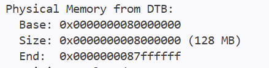

程序运行时输出：

```text
DTB Init
HartID: 0
DTB Address: 0x87e00000

Physical Memory from DTB:
 Base: 0x80000000
 Size: 0x08000000 (128 MB)
```

这说明内核能够通过 DTB 获取模拟环境的物理内存信息。

实验中物理内存起始地址为 `0x80000000`，总容量为 128 MB。

#### 6.3 空闲物理页初始化结果

物理内存管理系统初始化完成后，程序输出：

```text
memory management: default_pmm_manager
Free physical pages: 31929
check_alloc_page() succeeded!
```

其中：

- `default_pmm_manager` 表示当前使用的是默认物理页分配器，即 First-Fit。
- `Free physical pages: 31929` 表示系统初始化后共有 31929 个可分配物理页。
- `check_alloc_page() succeeded!` 表示默认页面分配器的内置检查成功执行。

实验结果表明，`page_init()` 能够正确识别可用物理内存区域，并将空闲页交给 First-Fit 分配器管理。

#### 6.4 测试结论
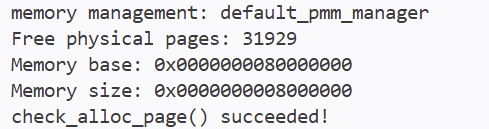

本实验已完成 `page_init()` 的实现，并通过实际运行验证了物理内存探测、空闲页初始化以及 First-Fit 分配器的基本功能。

需要说明的是，上述结果来自 `make qemu` 的实际运行，并不代表已经通过 `make grade` 的全部自动评分测试。完整自动评分由小组在最终集成阶段统一验证。

### 七、实验过程中遇到的问题与调试过程

#### 7.1 内核启动过程中未出现预期输出

在完成 `page_init()` 的实现后，使用 `make qemu` 运行内核时，最初未能正常进入内核初始化流程。

通过检查 QEMU 启动命令和 OpenSBI 输出，发现原始 Makefile 使用 `-device loader` 加载内核镜像，启动信息中的 `Domain0 Next Address` 为 `0x0`，未能正确进入预期的内核入口。

随后尝试使用 `-kernel bin/ucore.img` 加载内核，OpenSBI 显示内核入口地址为 `0x80200000`，说明内核加载和启动地址设置发生了变化。

#### 7.2 开启分页后的指令页错误

调整加载方式后，内核仍未正常输出初始化信息。

通过 GDB 调试，观察到以下异常信息：

- `scause = 0xc`
- `sepc = 0x80200038`
- `stval = 0x80200038`

其中，`scause = 0xc` 表示发生指令页错误。

进一步检查发现，异常发生在启动代码写入 `satp`、启用 Sv39 分页机制之后。此时 CPU 仍然需要从低地址取指，而当前启动页表缺少对应的低地址映射。

在本地测试中，为启动页表补充相应的低地址恒等映射后，内核能够继续执行并成功完成物理内存初始化。

需要说明的是，这一问题发生在进入 `page_init()` 之前，属于内核启动和地址映射方面的问题，并非物理内存初始化函数本身的逻辑错误。不同小组启动行为差异的具体原因仍待进一步核实。

#### 7.3 物理内存初始化功能验证

在内核能够正常启动后，继续观察 `page_init()` 及默认物理页分配器的运行结果。

系统成功识别 128 MB 物理内存，并输出：

`Free physical pages: 31929`

同时，默认分配器检查输出：

`check_alloc_page() succeeded!`

由此验证了物理内存范围获取、页描述符初始化、空闲页管理区建立及 First-Fit 基本分配功能。

#### 7.4 调试总结

本次调试过程中，通过检查启动参数、观察 OpenSBI 输出、使用 GDB 分析异常寄存器和页表映射，逐步定位了影响实验运行的问题。

实验也表明，内核无法正常运行时，需要区分启动加载、虚拟内存映射和具体功能模块三个不同层次的问题，避免将启动异常误判为 `page_init()` 的实现错误。


## 2. Best-Fit 物理内存分配算法


### 1. 实验目的

本部分实验主要实现 Best-Fit（最佳适应）物理内存分配算法，理解操作系统如何管理空闲物理页，以及如何通过不同的分配策略减少内存碎片。

### 2. Best-Fit 算法原理

Best-Fit 的基本思想是：当系统需要分配连续的 `n` 个物理页时，遍历空闲块链表，寻找所有能够满足请求的空闲块，并选择其中**大小最小的合适空闲块**。

例如，空闲链表中存在大小分别为 3、8、5 页的空闲块，申请 4 页时，Best-Fit 会优先选择 5 页的空闲块，而不是 8 页的空闲块。

如果找到的空闲块大于请求大小，则将剩余部分重新放回空闲链表。

### 3. 算法实现

本次实验在 `kern/mm/best_fit_pmm.c` 中完成 Best-Fit 内存管理器的实现。

#### 3.1 初始化空闲链表

在 `best_fit_init()` 中初始化空闲链表和空闲页计数器，为后续内存分配做好准备。

`best_fit_init_memmap()` 负责将指定范围内的物理页初始化为空闲页，并建立对应的空闲块信息。

#### 3.2 分配物理页

在 `best_fit_alloc_pages(size_t n)` 中遍历空闲链表，检查每个空闲块的大小。

对于能够满足 `n` 页请求的空闲块，比较其大小，最终选择满足条件且大小最小的块。

如果该块大小恰好等于 `n`，则直接从空闲链表中移除；如果大于 `n`，则将剩余部分保留为空闲块。

完成分配后更新空闲页数量。

#### 3.3 释放物理页

在 `best_fit_free_pages()` 中，将释放的连续物理页重新加入空闲链表。

为了便于合并相邻空闲块，释放时按照物理地址顺序插入，并检查是否能够与前后相邻的空闲块合并。

这样可以减少空闲内存被分割成多个小块的情况。

#### 3.4 查询空闲页数量

`best_fit_nr_free_pages()` 返回当前空闲物理页的总数，用于内存管理状态检查。

### 4. 编译与测试

为了避免影响小组其他成员负责的 `pmm.c`，本次测试将 `code` 目录复制到临时目录，在副本中切换内存管理器：

```bash
mkdir -p /tmp/oslab2-bestfit-test
cp -a code/. /tmp/oslab2-bestfit-test/
cd /tmp/oslab2-bestfit-test
```

在临时副本的 `kern/mm/pmm.c` 中，将当前内存管理器设置为：

```c
pmm_manager = &best_fit_pmm_manager;
```

然后重新编译：

```bash
make
```

编译成功后，使用 QEMU 启动内核：

```bash
qemu-system-riscv64 \
    -machine virt \
    -nographic \
    -bios default \
    -kernel bin/ucore.img
```

### 5. 实验结果
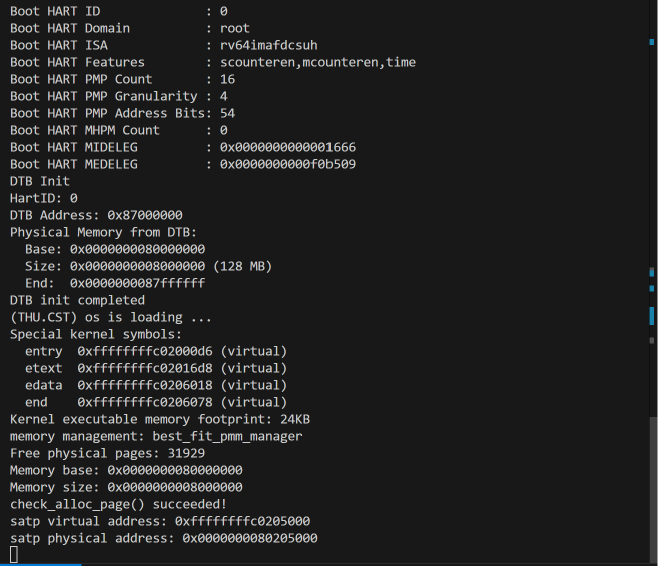

QEMU 成功启动内核，输出：

```text
(THU.CST) os is loading ...

memory management: best_fit_pmm_manager
Free physical pages: 31929
Memory base: 0x0000000080000000
Memory size: 0x0000000008000000
check_alloc_page() succeeded!
```

其中：

- `memory management: best_fit_pmm_manager` 说明当前使用的是 Best-Fit 内存管理器。
- `Free physical pages: 31929` 表示初始化后可用的空闲物理页数量。
- `check_alloc_page() succeeded!` 说明框架中的物理页分配检查成功完成。

测试过程中未出现断言失败或内核异常，说明本次 Best-Fit 实现通过了课程框架提供的运行检查。

### 6. 实验总结

通过本次实验，我理解了 Best-Fit 算法的主要实现过程。与找到第一个合适空闲块就进行分配的 First-Fit 不同，Best-Fit 需要遍历空闲链表，选择最接近申请大小的空闲块。

实现过程中，除了正确选择空闲块，还需要处理分配后的剩余空间，以及释放时相邻空闲块的合并。如果没有正确维护空闲链表和空闲页数量，就可能出现内存管理错误。

最后，通过在临时副本中切换内存管理器并使用 QEMU 运行测试，验证了 Best-Fit 的基本功能，同时避免修改小组共享的内存管理器配置文件。


## 3. Buddy System 物理内存管理


### 1. 任务说明

本部分实现 Buddy System 物理内存分配器，并接入实验已有的 pmm_manager 框架。

主要新增：
- kern/mm/buddy_pmm.c
- kern/mm/buddy_pmm.h

正常运行时在 pmm.c 中选择 buddy_pmm_manager。

### 2. 基本原理

Buddy System 按 order 管理不同大小的空闲块：

- order 0：1 页
- order 1：2 页
- order 2：4 页
- order 3：8 页

使用多个空闲链表保存不同大小的块，并使用 Page.property 记录块大小。

### 3. 初始化

buddy_init_memmap() 接收 page_init() 找到的连续可用物理内存，并按照地址对齐情况将其划分成若干个 2 的幂大小的空闲块，加入对应 order 的链表。

### 4. 分配

buddy_alloc_pages(n) 会把请求页数向上取整到 2 的幂。

例如：
- 申请 1 页，实际使用 1 页块
- 申请 3 页，实际使用 4 页块
- 申请 5 页，实际使用 8 页块

如果当前 order 没有空闲块，就寻找更大的块并不断拆分。

### 5. 释放和合并

释放时根据块大小确定 order，并使用：

buddy_index = index ^ block_pages

计算伙伴块。

如果伙伴块为空闲状态且大小相同，就把两个块合并成更高一级的块，并继续尝试合并。

### 6. Buddy 测试
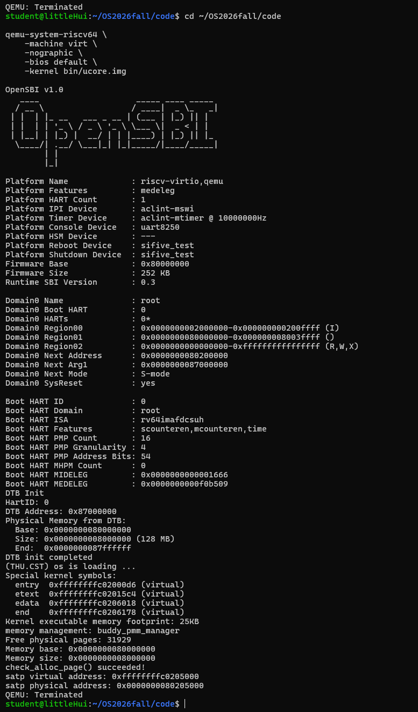

buddy_check() 中测试了：

1. 保存初始空闲页数和各 order 块数量；
2. 分别申请 1、3、5 页；
3. 验证实际块大小为 1、4、8 页；
4. 验证空闲页数减少 13 页；
5. 验证过大申请返回 NULL；
6. 按不同顺序释放；
7. 验证总空闲页数恢复；
8. 验证各 order 空闲块数量恢复。

执行：

make qemu

实际输出：

memory management: buddy_pmm_manager
Free physical pages: 31929
check_alloc_page() succeeded!

说明 Buddy 已成功运行并通过测试。

测试截图：
report/images/buddy_check.png

### 7. 环境适配

本组环境为 QEMU 7.0.0 和 OpenSBI v1.0。

原始启动方式使用 -device loader 时：

Domain0 Next Address : 0x0

因此将启动方式调整为：

-kernel $(UCOREIMG)

修改后：

Domain0 Next Address : 0x80200000

可以正常进入内核。

同时启动页表增加低地址恒等映射，使开启 Sv39 分页后当前低地址代码能够继续执行。

### 8. 最终验证

现场演示命令：

make qemu
make grade
make gdb

结果：

- make qemu：Buddy 正常运行，check_alloc_page() succeeded!
- make grade：Page Init 和 Best-Fit 均通过，Total Score: 20/20
- make gdb：自动启动 QEMU 并连接 GDB，停在 0x1000

最终 Buddy System 可以正常完成初始化、拆分、分配、释放和伙伴合并。


## 4. GDB、Sv39、MMU 与 TLB 调试


### 1. 实验目的

本部分实验使用 QEMU 和 GDB 调试 RISC-V 内核启动过程，重点观察 `satp` 寄存器的变化，理解 Sv39 分页机制、页表地址转换过程以及 TLB 的作用。

此外，结合 QEMU 提供的 MMU 调试日志，观察模拟器的 TLB 填充与地址转换过程，将实际运行日志与 GDB 调试结果进行对照验证。

### 2. 实验环境

- 操作系统：Ubuntu 22.04.5 LTS（WSL2）
- 目标架构：RISC-V 64
- 模拟器：QEMU 7.0.0
- 调试工具：RISC-V GDB
- 实验内核：uCore
- 交叉编译器：RISC-V GCC 15.1.0

本实验使用修复后的启动环境，`Makefile` 采用 `-kernel` 参数加载内核镜像，`entry.S` 的启动页表同时包含低地址恒等映射和高地址映射。

### 3. 实验过程

#### 3.1 启动 QEMU 与 GDB
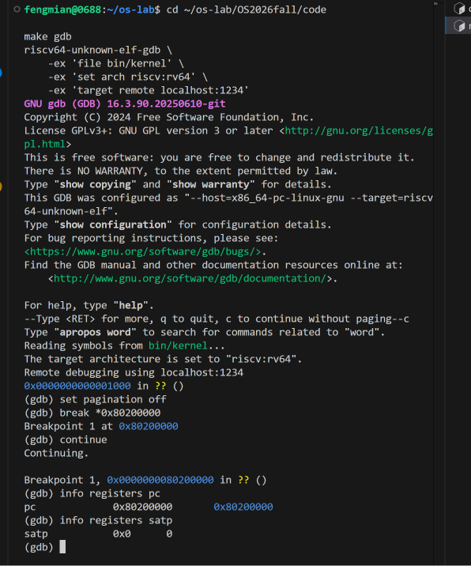

在 `code` 目录下启动 QEMU：

```bash
qemu-system-riscv64 \
    -machine virt \
    -nographic \
    -bios default \
    -kernel bin/ucore.img \
    -s -S
```

其中，`-s` 用于启动 GDB 调试服务，`-S` 使 CPU 在启动时暂停，等待调试器连接。

在另一个终端执行：

```bash
make gdb
```

连接成功后，设置内核物理入口断点：

```gdb
break *0x80200000
continue
info registers pc
info registers satp
```

得到：

```text
pc   = 0x80200000
satp = 0x0
```

此时内核已经到达物理入口地址，但还没有启用 Sv39 分页。

#### 3.2 观察 Sv39 分页开启过程
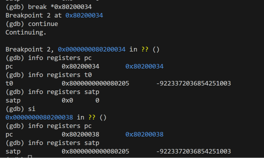

使用 GDB 反汇编内核入口附近的指令：

```gdb
x/35i $pc
```

发现两条关键指令：

```asm
0x80200034: csrw satp,t0
0x80200038: sfence.vma
```

在写入 `satp` 之前设置断点：

```gdb
break *0x80200034
continue
```

检查寄存器：

```text
pc   = 0x80200034
t0   = 0x8000000000080205
satp = 0x0
```

执行单步调试：

```gdb
si
info registers pc
info registers satp
```

结果为：

```text
pc   = 0x80200038
satp = 0x8000000000080205
```

说明执行 `csrw satp,t0` 后，CPU 的地址转换模式已经由 Bare 切换为 Sv39。

对 `satp` 的分析如下：

- MODE = 8：使用 Sv39 分页模式。
- ASID = 0：地址空间标识符为 0。
- PPN = 0x80205：根页表的物理页号。

因此根页表物理地址为：

```text
0x80205 × 4096 = 0x80205000
```

接着执行 `sfence.vma`：

```gdb
si
info registers pc
info registers satp
```

得到：

```text
pc   = 0x8020003c
satp = 0x8000000000080205
```

说明 `sfence.vma` 已执行，`satp` 的值保持不变。该指令用于同步地址转换相关状态，使后续地址转换遵循相应的页表配置。

#### 3.3 分析 Sv39 根页表
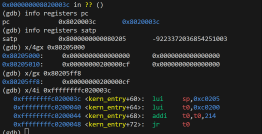

使用 GDB 查看根页表：

```gdb
x/4gx 0x80205000
```

结果：

```text
0x80205000:
0x0000000000000000  0x0000000000000000

0x80205010:
0x00000000200000cf  0x0000000000000000
```

因此：

```text
PTE[2] = 0x200000cf
```

继续查看根页表的第 511 项：

```gdb
x/gx 0x80205ff8
```

结果：

```text
PTE[511] = 0x200000cf
```

两个页表项具有相同的值，说明它们映射到同一个物理内存区域。

其中，`0x200000cf` 的低位标志包含：

- V = 1：有效
- R = 1：可读
- W = 1：可写
- X = 1：可执行
- A = 1：已访问
- D = 1：已修改

由于这两个页表项位于 Sv39 根页表中，并且设置了读写执行权限，因此它们是叶子页表项，形成 1 GiB 大页映射。

Sv39 通常采用三级页表结构，但允许在较高层级直接使用大页。本实验启动阶段的映射就在根页表层级结束，没有继续访问下两级页表。

#### 3.4 验证虚拟地址与物理地址转换
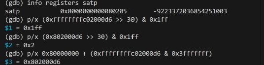

内核的高虚拟地址为：

```text
0xffffffffc02000d6
```

在 GDB 中计算该地址的 VPN[2]：

```gdb
p/x (0xffffffffc02000d6 >> 30) & 0x1ff
```

结果：

```text
$1 = 0x1ff
```

即根页表索引为 511。

对低地址进行同样的计算：

```gdb
p/x (0x802000d6 >> 30) & 0x1ff
```

结果：

```text
$2 = 0x2
```

即根页表索引为 2。

由于两个根页表项均指向物理地址 `0x80000000` 开始的 1 GiB 区域，因此对于该高虚拟地址：

```text
物理地址 = 0x80000000 + (虚拟地址 & 0x3fffffff)
```

在 GDB 中执行：

```gdb
p/x 0x80000000 + (0xffffffffc02000d6 & 0x3fffffff)
```

结果：

```text
$3 = 0x802000d6
```

说明：

```text
高虚拟地址：0xffffffffc02000d6
对应物理地址：0x802000d6
```

这验证了当前页表的高地址映射关系。

#### 3.5 验证内核高虚拟地址执行
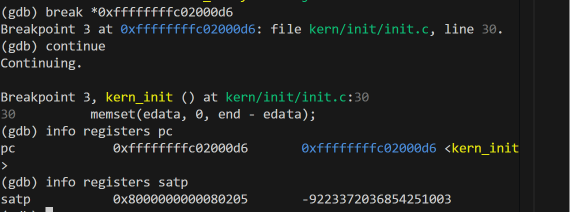

在 `kern_init()` 入口设置断点：

```gdb
break *0xffffffffc02000d6
continue
```

成功命中断点：

```text
Breakpoint 3, kern_init () at kern/init/init.c:30
```

查看寄存器：

```text
pc   = 0xffffffffc02000d6
satp = 0x8000000000080205
```

进一步反汇编：

```gdb
x/4i $pc
```

得到：

```asm
0xffffffffc02000d6 <kern_init>:     auipc a0,0x6
0xffffffffc02000da <kern_init+4>:   addi  a0,a0,-190
0xffffffffc02000de <kern_init+8>:   auipc a2,0x6
0xffffffffc02000e2 <kern_init+12>:  addi  a2,a2,-102
```

说明 CPU 已经成功到达内核高虚拟地址，且仍处于 Sv39 分页模式。

#### 3.6 QEMU MMU 日志与 TLB 填充验证

前面通过 GDB 观察了分页开启、根页表内容以及虚拟地址到物理地址的计算过程。为了进一步验证实际运行中的地址转换，使用 QEMU 的 MMU 日志功能记录内核执行时的地址转换活动。

##### 3.6.1 检查 QEMU 日志功能

在终端执行：

```bash
qemu-system-riscv64 -d help
```

发现当前 QEMU 支持以下调试选项：

```text
mmu    log MMU-related activities
int    show interrupts/exceptions in short format
```

其中，`mmu` 用于输出 MMU 相关活动，`int` 用于输出异常和中断相关记录。

##### 3.6.2 启用 MMU 调试日志

为了保持课程要求的 `make qemu` 启动方式，在 `Makefile` 的 QEMU 启动命令末尾增加可选参数变量：

```makefile
-kernel $(UCOREIMG) $(QEMUOPTS)
```

普通运行仍然执行：

```bash
make qemu
```

进行 MMU 调试时执行：

```bash
make qemu QEMUOPTS="-d mmu,int -D /tmp/lab2-mmu.log"
```

其中：

- `-d mmu,int`：开启 MMU 与异常相关日志。
- `-D /tmp/lab2-mmu.log`：将日志写入指定文件。

运行后成功生成：

```text
/tmp/lab2-mmu.log
```

该次日志大小约为 346 KB。

##### 3.6.3 提取高虚拟地址的 TLB 填充记录

通过以下命令筛选内核高虚拟地址的访问记录：

```bash
grep -Ei 'riscv_cpu_tlb_fill (ad|address=) ffffffff' /tmp/lab2-mmu.log | head -40
```

其中，发现之前 GDB 调试过的 `kern_init()` 入口地址：

```text
riscv_cpu_tlb_fill ad ffffffffc02000d6 rw 2 mmu_idx 1
```

为了查看该地址对应的完整转换结果，进一步执行：

```bash
grep -A 3 -m 1 'riscv_cpu_tlb_fill ad ffffffffc02000d6' /tmp/lab2-mmu.log
```

得到：

```text
riscv_cpu_tlb_fill ad ffffffffc02000d6 rw 2 mmu_idx 1
riscv_cpu_tlb_fill address=ffffffffc02000d6 ret 0 physical 00000000802000d6 prot 7
riscv_cpu_tlb_fill PMP address=00000000802000d6 ret 0 prot 7 tlb_size 4096
riscv_cpu_tlb_fill ad ffffffffc0204ff8 rw 1 mmu_idx 1
```

其中：

- `ad ffffffffc02000d6`：待转换的内核高虚拟地址。
- `rw 2`：表示指令取指访问。
- `mmu_idx 1`：QEMU 内部使用的 MMU 上下文索引。
- `ret 0`：本次地址转换成功。
- `physical 00000000802000d6`：转换得到的物理地址。
- `prot 7`：QEMU 内部记录的访问权限掩码。
- `tlb_size 4096`：此次 QEMU 内部 TLB 缓存记录的粒度为 4096 字节。

需要注意，启动页表采用的是 1 GiB 大页映射，而日志中的 `tlb_size 4096` 是此次模拟器内部缓存记录的粒度，并不表示 Sv39 的映射页大小变成了 4 KiB。


##### 3.6.4 对照 Sv39 页表分析结果

前面通过 GDB 已经得到：

```text
satp = 0x8000000000080205
根页表物理地址 = 0x80205000
VPN[2] = 511
PTE[511] = 0x200000cf
```

根据根页表中的 1 GiB 大页映射关系，计算得到：

```text
虚拟地址：0xffffffffc02000d6
           ↓
根页表项：PTE[511]
           ↓
物理地址：0x802000d6
```

而本次 QEMU 日志实际记录：

```text
address=ffffffffc02000d6
ret 0
physical 00000000802000d6
```

两次结果完全一致。

由此说明，QEMU 对内核高虚拟地址的取指访问成功完成了地址转换，并得到了与 GDB 页表分析一致的物理地址。

QEMU 的 `riscv_cpu_tlb_fill` 日志可以作为模拟器执行地址转换和 TLB 填充处理的证据，但它并不直接提供真实硬件的 TLB 命中率，也不代表已经观察到所有内部页表遍历步骤。

### 4. TLB 机制分析

TLB（Translation Lookaside Buffer）用于缓存虚拟地址到物理地址的转换信息，以减少重复页表查询产生的开销。

当 CPU 访问虚拟地址时，地址转换通常涉及以下过程：

1. CPU 发起虚拟地址访问。
2. 检查 TLB 中是否存在可用的地址转换信息。
3. 如果存在有效的缓存结果，可以直接使用该转换信息。
4. 如果没有对应的缓存结果，则需要执行页表查询，获得相应的物理地址和权限信息。
5. 转换结果可以被缓存，以便后续访问使用。

本实验在内核入口观察到了：

```asm
csrw satp,t0
sfence.vma
```

其中，`csrw satp,t0` 配置分页模式和根页表位置；`sfence.vma` 用于同步地址转换相关状态，使后续地址转换正确反映页表配置。

在本次实验中，GDB 显示写入 `satp` 后：

```text
satp = 0x8000000000080205
```

CPU 启用了 Sv39 分页模式。

随后，通过读取根页表，观察到：

```text
PTE[2]   = 0x200000cf
PTE[511] = 0x200000cf
```

这两个页表项分别提供低地址恒等映射和内核高地址映射，均映射到相同的物理内存区域。

在 QEMU 的 MMU 调试日志中，进一步观察到：

```text
riscv_cpu_tlb_fill ad ffffffffc02000d6 rw 2 mmu_idx 1
riscv_cpu_tlb_fill address=ffffffffc02000d6 ret 0 physical 00000000802000d6 prot 7
```

这说明模拟器在处理内核高虚拟地址的取指请求时，执行了地址转换和 TLB 填充相关处理，成功获得物理地址 `0x802000d6`。

因此，本次实验从两个角度验证了 Sv39 地址转换：

- **GDB 调试：** 通过 `satp`、根页表项和 VPN 索引计算物理地址。
- **QEMU MMU 日志：** 通过模拟器记录的 TLB 填充操作观察实际地址转换结果。

本次实验未直接读取真实硬件的 TLB 内部条目，也没有测量 TLB 命中率。同时，由于启动页表使用的是根页表级别的 1 GiB 大页映射，地址转换在根页表即可完成，不需要继续访问下两级页表。

因此，本次记录主要反映 QEMU 模拟的地址转换与 TLB 填充过程，而不是完整的硬件 TLB 性能测试。

### 5. 实验总结

通过本次调试，我理解了 RISC-V 内核开启 Sv39 分页的基本过程。内核首先准备根页表地址，将 Sv39 配置写入 `satp`，再执行 `sfence.vma` 同步地址转换状态，最后跳转到高虚拟地址继续执行。

实验中读取到的 `PTE[2]` 和 `PTE[511]` 均为 `0x200000cf`，验证了低地址与高地址映射到同一物理内存区域的关系。通过计算 VPN[2] 和物理地址，也进一步理解了 Sv39 的地址转换方法。

本实验使用的是根页表级别的 1 GiB 大页映射，因此虽然 Sv39 支持三级页表，实际启动映射并不需要完整遍历三级页表。

在原有 GDB 调试的基础上，本次还使用了 QEMU 的 `mmu` 调试日志，获取到 `riscv_cpu_tlb_fill` 记录，观察了内核高虚拟地址 `0xffffffffc02000d6` 对应的地址转换过程。

日志显示转换成功，得到物理地址 `0x802000d6`，与之前 GDB 的计算结果完全一致。这使得实验不仅能够从页表结构推导转换结果，还能通过模拟器的实际运行日志进行验证。

通过本次实验，我对 MMU、Sv39 页表和 TLB 的关系有了更具体的认识：页表保存地址映射关系，MMU 根据页表或缓存的转换信息完成地址转换，而 TLB 的作用是缓存转换结果、提高地址访问效率。

相比只阅读源码，GDB 的单步调试和 QEMU MMU 日志能够更直观地帮助理解内核从物理地址启动、开启分页，再到高虚拟地址运行的过程。


## 5. 硬件内存范围 Challenge


### 1. 问题背景

原 Lab2 的物理内存初始化主要针对 QEMU virt 平台，系统通过 `get_memory_base()` 和 `get_memory_size()` 获取一段连续物理内存，并默认其起始地址为 `DRAM_BASE`。

真实硬件的物理地址空间可能包含多个不连续 RAM 区域、固件保留区域以及 reserved-memory。因此本 Challenge 对 DTB 解析和 `page_init()` 进行了扩展，使系统能够依据设备树提供的物理内存布局初始化物理内存管理器。

### 2. DTB 多内存区域解析

原实现找到第一个 `memory` 节点的 `reg` 属性后立即返回，只能获得一组 `base + size`。

修改后支持：
- 枚举多个 `memory` 节点；
- 解析一个 `reg` 属性中的多组 `<base, size>`；
- 读取根节点的 `#address-cells` 和 `#size-cells`；
- 解析 FDT memory reservation block；
- 解析 `/reserved-memory` 子节点；
- 保存多个 RAM region 和 reserved region。

当前 QEMU 环境识别结果：

```text
Physical Memory Regions from DTB: 1
  Region 0: 0x0000000080000000 - 0x0000000087ffffff (128 MB)
Reserved Memory Regions from DTB: 1
  Reserved 0: 0x0000000080000000 - 0x000000008003ffff
```

### 3. PMM 按 DTB 内存范围初始化

新的 `page_init()` 会：
1. 获取 DTB 中所有 RAM region；
2. 建立 `Page` 描述符数组，并默认标记为 Reserved；
3. 逐个处理 RAM region；
4. 排除内核、Page 描述符数组和 reserved region；
5. 将剩余连续页对齐区间分别通过 `init_memmap()` 加入 PMM。

这样即使 RAM 中存在地址空洞或保留区，对应页面也不会被错误分配。

### 4. 实验结果

```text
PMM physical memory regions from DTB: 1
Page metadata: 0x0000000080207000 - 0x0000000080346fff
RAM region 0 candidate: 0x0000000080347000 - 0x0000000087ffffff
  Usable RAM: 0x0000000080347000 - 0x0000000087ffffff (31929 pages)
Free physical pages from DTB regions: 31929
check_alloc_page() succeeded!
```

原 Lab2 测试仍通过：

```text
-check page init: OK
-check best fit: OK
Total Score: 20/20
```

`make gdb` 仍可正常连接：

```text
Remote debugging using localhost:1234
0x0000000000001000 in ?? ()
```

### 5. 当前实现边界

当前实验内核仍使用固定的 `DRAM_BASE`、`PHYSICAL_MEMORY_END` 和高地址直接映射窗口。因此本实现可以发现窗口外 RAM，但只将当前内核支持物理地址窗口内的 RAM 加入 PMM。若要支持完全任意硬件布局，还需要继续修改内核直接映射、`nbase` 和页表建立方式。


## 6. Sv39 GDB 智能调试流程演示


### 1. 实验目的

本加分题在 Lab2 必做部分的 GDB/MMU/Sv39 调试基础上，进一步实现一个可重复使用的地址转换调试工具。

在基础实验中，我们通过 GDB 手动读取 `satp` 寄存器、定位 Sv39 根页表、计算 VPN 索引、读取页表项，并根据页表映射关系计算物理地址。虽然能够完成地址转换分析，但需要输入多条命令，操作比较繁琐，也不容易展示完整的页表查询过程。

因此，本次加分实验希望将这些操作整合为一条 GDB 自定义命令，实现以下目标：

1. 自动获取当前 CPU 的分页配置。
2. 自动计算虚拟地址对应的 VPN 索引。
3. 自动定位、读取和解析 Sv39 页表项。
4. 支持逐级查询 L2、L1、L0 页表。
5. 识别不同层级的叶子页表项并计算物理地址。
6. 对无效页表项、非规范虚拟地址等情况提供错误提示。
7. 将调试过程整理为可复现的演示材料，帮助理解 MMU、TLB 和 Sv39 地址转换机制。

本工具主要用于教学演示和辅助调试，不修改内核实际地址转换逻辑。

### 2. 实验环境

| 项目 | 实验配置 |
|---|---|
| 操作系统 | Ubuntu 22.04.5 LTS（WSL2） |
| 目标架构 | RISC-V 64 |
| 模拟器 | QEMU 7.0.0 |
| 调试工具 | RISC-V GDB 16.3.90 |
| 编译工具 | RISC-V GCC 15.1.0 |
| 实验内核 | uCore |
| 脚本语言 | GDB 原生命令脚本 |
| 开发分支 | `zxy-lab2-challenge-b` |

本实验沿用 Lab2 基础实验中已经修复的 QEMU 启动环境。

由于当前使用的 RISC-V GDB 不支持 Python 脚本功能，最终采用 GDB 自带的 `define`、`if`、`while`、`set` 和 `printf` 等命令实现自动化调试，不依赖额外的 Python-GDB 环境。

### 3. 工具设计

#### 3.1 基本思路

本工具定义了一个新的 GDB 命令：

```gdb
sv39walk <virtual_address>
```

用户只需要输入一个虚拟地址，工具就会自动读取当前分页配置，并尝试完成 Sv39 页表查询。

例如：

```gdb
sv39walk 0xffffffffc02000d6
```

工具的基本执行流程如下：

```text
输入虚拟地址
      |
      v
读取 satp 寄存器
      |
      v
检查是否启用 Sv39
      |
      v
检查虚拟地址是否合法
      |
      v
计算 VPN[2]、VPN[1]、VPN[0]
      |
      v
获取根页表物理地址
      |
      v
从 L2 页表开始查询
      |
      v
读取 PTE，检查有效位和权限位
      |
      +---- 无效 PTE ------> 输出错误信息
      |
      +---- 非叶子 PTE ----> 进入下一级页表
      |
      +---- 叶子 PTE -----> 检查大页对齐
                                  |
                                  v
                         计算最终物理地址
                                  |
                                  v
                             输出结果
```

#### 3.2 Sv39 地址结构

Sv39 使用 39 位有效虚拟地址，虚拟地址由三个 VPN 索引和页内偏移组成：

| 字段 | 位范围 | 位数 |
|---|---|---|
| VPN[2] | 38～30 | 9 |
| VPN[1] | 29～21 | 9 |
| VPN[0] | 20～12 | 9 |
| Offset | 11～0 | 12 |

在 RV64 系统中，Sv39 虚拟地址还需要满足符号扩展规则：第 63～39 位必须与第 38 位一致。

工具首先检查这一规则，避免将非规范地址当作正常地址查询。

VPN 的计算方式为：

```text
VPN[2] = (VA >> 30) & 0x1ff
VPN[1] = (VA >> 21) & 0x1ff
VPN[0] = (VA >> 12) & 0x1ff

Offset = VA & 0xfff
```

#### 3.3 satp 寄存器解析

RISC-V RV64 的 `satp` 寄存器主要包含：

- MODE：分页模式。
- ASID：地址空间标识符。
- PPN：根页表物理页号。

在 Sv39 模式下：

```text
MODE = 8
```

根页表物理地址由以下公式计算：

```text
Root PA = satp.PPN << 12
```

本实验实际读取到：

```text
satp = 0x8000000000080205
```

解析得到：

```text
MODE = 8
PPN  = 0x80205

Root PA = 0x80205000
```

#### 3.4 页表逐级查询设计

Sv39 最多使用三级页表：

- L2：根页表。
- L1：中间层页表。
- L0：最后一级页表。

每个页表项占 8 字节，每级通过对应 VPN 索引定位页表项。

页表项地址计算公式为：

```text
PTE Address = Table PA + VPN[level] × 8
```

读取 PTE 后，检查以下标志位：

| 标志位 | 作用 |
|---|---|
| V | 页表项是否有效 |
| R | 是否可读 |
| W | 是否可写 |
| X | 是否可执行 |

工具主要按照以下规则判断：

1. 如果 `V=0`，判定为无效页表项。
2. 如果 `W=1` 且 `R=0`，判定为非法权限组合。
3. 如果 `R=1` 或 `X=1`，将当前页表项视为叶子页表项。
4. 否则尝试根据 PTE 中的 PPN 进入下一级页表。

不同层级的叶子页表项对应不同映射大小：

| 叶子页表层级 | 映射页大小 |
|---|---|
| L2 | 1 GiB |
| L1 | 2 MiB |
| L0 | 4 KiB |

如果是 L2 或 L1 大页，还需要检查物理页号是否符合大页对齐要求。

本工具已经编写 L2、L1、L0 逐级遍历逻辑，但当前实际运行的启动页表使用 L2 的 1 GiB 大页映射，因此本次实测主要验证 L2 路径。

### 4. 工具实现

#### 4.1 文件结构

本加分项的主要文件为：

```text
OS2026fall/
├── tools/
│   └── sv39/
│       ├── sv39_walk.gdb
│       └── sv39_walk.py
└── report/
    ├── drafts/
    │   └── bonus_gdb_agent.md
    └── images/
        ├── bonus_gdb_high.png
        ├── bonus_gdb_low.png
        ├── bonus_gdb_invalid.png
        └── bonus_gdb_noncanonical.png
```

其中：

- `sv39_walk.gdb`：本次实际运行并通过测试的 GDB 原生命令脚本。
- `sv39_walk.py`：前期尝试的 Python-GDB 版本，因当前 GDB 不支持 Python 而未完成运行验证。
- `bonus_gdb_agent.md`：本次加分题实验报告。
- `bonus_gdb_*.png`：工具实际执行截图。

#### 4.2 核心功能实现

GDB 脚本首先注册自定义命令：

```gdb
define sv39walk
```

使用 `$arg0` 接收输入地址：

```gdb
set $va = (unsigned long long)$arg0
```

读取当前 `satp`：

```gdb
set $satp_value = (unsigned long long)$satp
set $mode = ($satp_value >> 60) & 0xf
```

获取根页表地址：

```gdb
set $root = ($satp_value & 0xfffffffffff) << 12
```

随后计算 VPN 索引：

```gdb
set $vpn2 = ($va >> 30) & 0x1ff
set $vpn1 = ($va >> 21) & 0x1ff
set $vpn0 = ($va >> 12) & 0x1ff
```

逐级查询时，通过页表基址和 VPN 计算 PTE 地址：

```gdb
set $pte_addr = $table + $vpn * 8
set $pte = *(unsigned long long *)$pte_addr
```

再解析 PTE 标志位：

```gdb
set $v = $pte & 1
set $r = ($pte >> 1) & 1
set $w = ($pte >> 2) & 1
set $x = ($pte >> 3) & 1
```

当检测到叶子页表项时，根据当前层级确定页大小，并计算物理地址：

```gdb
set $page_bits = 12 + 9 * $level
set $page_mask = (1ULL << $page_bits) - 1
set $pa = (($ppn << 12) & ~$page_mask) | ($va & $page_mask)
```

最后输出页大小和物理地址。

工具还包含错误处理逻辑，例如：

```text
ERROR: Invalid PTE
ERROR: Misaligned superpage
ERROR: Non-canonical Sv39 virtual address
```

需要说明的是，这些错误提示主要用于教学演示。工具当前只实现了基础页表合法性检查，尚未完整模拟 RISC-V 所有访问权限、A/D 位及异常检查规则。

### 5. 实验操作过程

#### 5.1 启动 QEMU 调试环境

本实验保留课程要求的 `make qemu` 启动方式。

在第一个 WSL 终端执行：

```bash
cd ~/os-lab/OS2026fall/code
make qemu QEMUOPTS="-s -S"
```

其中：

- `-s`：启动 QEMU 的 GDB 调试服务，默认使用 TCP 端口 1234。
- `-S`：使 CPU 在启动时暂停，等待 GDB 连接。

普通内核运行仍然可以使用：

```bash
make qemu
```

#### 5.2 启动 GDB

在第二个 WSL 终端执行：

```bash
cd ~/os-lab/OS2026fall/code
make gdb
```

连接成功后，设置内核入口断点：

```gdb
set pagination off
break *0x80200000
continue
```

实际观察结果：

```text
pc   = 0x80200000
satp = 0x0
```

说明 CPU 已经到达内核物理入口，此时尚未启用分页。

#### 5.3 观察 Sv39 分页开启

设置断点：

```gdb
break *0x80200034
continue
```

实际停在：

```text
0x80200034
```

查看指令：

```gdb
x/i $pc
```

得到：

```asm
0x80200034: csrw satp,t0
```

执行前：

```text
t0   = 0x8000000000080205
satp = 0x0
```

单步执行：

```gdb
si
info registers satp
```

实际得到：

```text
satp = 0x8000000000080205
```

说明 Sv39 分页已开启。

继续执行 `sfence.vma`，随后检查根页表：

```gdb
x/gx 0x80205010
x/gx 0x80205ff8
```

实际输出：

```text
0x80205010: 0x00000000200000cf
0x80205ff8: 0x00000000200000cf
```

分别对应：

```text
PTE[2]   = 0x200000cf
PTE[511] = 0x200000cf
```

#### 5.4 加载自定义调试工具

在 GDB 中运行到 `kern_init()`：

```gdb
break *0xffffffffc02000d6
continue
```

随后加载脚本：

```gdb
source /home/fengmian/os-lab/OS2026fall/tools/sv39/sv39_walk.gdb
```

加载成功后，即可使用自定义命令：

```gdb
sv39walk <virtual_address>
```

整个过程中不需要重新编译内核，也不需要额外安装支持 Python 的 GDB。

### 6. 测试设计与实际结果

本次共完成四组测试，分别覆盖高地址映射、低地址映射、无效页表项和非规范虚拟地址。

#### 6.1 测试一：内核高虚拟地址转换

执行：

```gdb
sv39walk 0xffffffffc02000d6
```

实际输出：

```text
===== Sv39 Page Table Debugger =====
Virtual address: 0xffffffffc02000d6
SATP: 0x8000000000080205
Mode: Sv39
Root page table: 0x0000000080205000
VPN[2]: 511
VPN[1]: 1
VPN[0]: 0
Page offset: 0x0d6

[L2] Table PA: 0x0000000080205000
[L2] VPN index: 511
[L2] PTE address: 0x0000000080205ff8
[L2] PTE value: 0x00000000200000cf
Flags: V=1 R=1 W=1 X=1
Page size: 1 GiB
Physical address: 0x00000000802000d6
Translation successful!
====================================
```

该测试表明工具能够自动找到高地址对应的根页表项，并成功计算物理地址：

```text
VA = 0xffffffffc02000d6
PA = 0x802000d6
```

这一结果与之前 GDB 手动计算以及 QEMU MMU 日志中的地址转换结果一致。

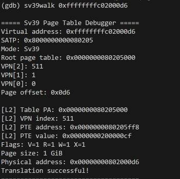

#### 6.2 测试二：低地址恒等映射

执行：

```gdb
sv39walk 0x802000d6
```

实际输出中的关键部分：

```text
Virtual address: 0x00000000802000d6
VPN[2]: 2
Root page table: 0x0000000080205000

[L2] PTE address: 0x0000000080205010
[L2] PTE value: 0x00000000200000cf
Flags: V=1 R=1 W=1 X=1

Page size: 1 GiB
Physical address: 0x00000000802000d6
Translation successful!
```

可以看到：

```text
VA = 0x802000d6
PA = 0x802000d6
```

低地址与高地址分别通过 `PTE[2]` 和 `PTE[511]`，最终映射到同一物理地址。

该测试说明工具能够根据不同 VPN 索引正确定位不同根页表项，而不是将物理地址直接写死。

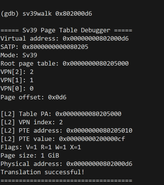

#### 6.3 测试三：无效页表项

执行：

```gdb
sv39walk 0x40000000
```

实际输出：

```text
===== Sv39 Page Table Debugger =====
Virtual address: 0x0000000040000000
SATP: 0x8000000000080205
Mode: Sv39
Root page table: 0x0000000080205000
VPN[2]: 1
VPN[1]: 0
VPN[0]: 0
Page offset: 0x000

[L2] Table PA: 0x0000000080205000
[L2] VPN index: 1
[L2] PTE address: 0x0000000080205008
[L2] PTE value: 0x0000000000000000
Flags: V=0 R=0 W=0 X=0
ERROR: Invalid PTE
====================================
```

该地址对应根页表的 `PTE[1]`。

由于读取到的页表项为 `0x0`，有效位 `V=0`，因此工具正确报告：

```text
ERROR: Invalid PTE
```

本测试验证了工具能够识别当前页表中不存在有效映射的地址，而不是无条件输出物理地址。

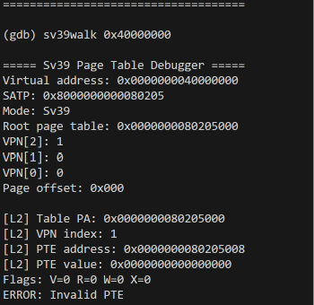

#### 6.4 测试四：非规范 Sv39 虚拟地址

执行：

```gdb
sv39walk 0x0000008000000000
```

实际输出：

```text
===== Sv39 Page Table Debugger =====
Virtual address: 0x0000008000000000
SATP: 0x8000000000080205
ERROR: Non-canonical Sv39 virtual address
====================================
```

根据 Sv39 的地址规范，虚拟地址高位必须满足符号扩展要求。

本次输入的地址不符合该规则，因此工具没有继续查询页表，而是直接输出：

```text
ERROR: Non-canonical Sv39 virtual address
```

说明工具能够在查询前进行虚拟地址合法性检查。

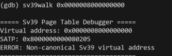

#### 6.5 测试结果汇总

| 测试编号 | 测试内容 | 预期结果 | 实际结果 |
|---|---|---|---|
| 1 | 高虚拟地址转换 | 输出 `0x802000d6` | 通过 |
| 2 | 低地址恒等映射 | 输出 `0x802000d6` | 通过 |
| 3 | 无效页表项 | 报告 `Invalid PTE` | 通过 |
| 4 | 非规范虚拟地址 | 报告 `Non-canonical` | 通过 |

四组测试均得到预期输出。

需要说明的是，这四组测试全部基于现有内核的 1 GiB 大页启动映射，尚未完成针对真实 L1、L0 页表映射的独立验证。

### 7. TLB、MMU 与 Sv39 地址转换机制分析

#### 7.1 TLB 的作用

TLB（Translation Lookaside Buffer）是用于缓存地址转换结果的结构。

CPU 访问虚拟地址时，可以先检查 TLB 中是否存在可用的转换信息。

如果 TLB 命中，就能够使用已有转换结果，减少页表查询开销。

如果 TLB 未命中，则需要通过地址转换机制查询页表，找到对应的物理地址及权限信息。

Sv39 页表查询可能涉及三级页表，但如果遇到 1 GiB 或 2 MiB 大页叶子项，可以提前结束查询。

#### 7.2 本工具与 TLB miss 的关系

本次 `sv39walk` 并不是直接控制真实 CPU 的 TLB，也不负责统计 TLB 命中次数。

它的主要功能是：

**模拟和展示发生 TLB miss 后，如何根据当前 `satp` 和 Sv39 页表计算地址转换结果。**

例如，对于：

```text
0xffffffffc02000d6
```

工具自动完成：

```text
读取 satp
    ↓
获取根页表 PA = 0x80205000
    ↓
计算 VPN[2] = 511
    ↓
读取 PTE[511] = 0x200000cf
    ↓
识别 1 GiB 叶子页表项
    ↓
计算物理地址 PA = 0x802000d6
```

这条过程能够直观展示页表查询和物理地址形成的逻辑。

#### 7.3 与 QEMU MMU 日志交叉验证

在 Lab2 基础调试中，我们还使用了 QEMU 的 MMU 日志功能：

```bash
make qemu QEMUOPTS="-d mmu,int -D /tmp/lab2-mmu.log"
```

得到过以下实际记录：

```text
riscv_cpu_tlb_fill ad ffffffffc02000d6 rw 2 mmu_idx 1
riscv_cpu_tlb_fill address=ffffffffc02000d6 ret 0 physical 00000000802000d6 prot 7
riscv_cpu_tlb_fill PMP address=00000000802000d6 ret 0 prot 7 tlb_size 4096
```

日志说明 QEMU 在处理对应高虚拟地址的取指访问时，执行了 TLB 填充相关处理，并成功得到物理地址 `0x802000d6`。

该结果与本工具自动计算出的地址完全一致。

因此，本实验通过两种方法进行验证：

- GDB 原生脚本：读取页表并自动计算物理地址。
- QEMU MMU 日志：观察模拟器实际运行过程中的地址转换结果。

需要注意，这并不代表已经测量真实硬件的 TLB 命中率，也不代表可以读取 QEMU 内部所有 TLB 缓存项。

### 8. 工具特点与不足

#### 8.1 主要特点

**（1）操作简单**

原本需要分别读取 `satp`、计算 VPN、定位 PTE 和计算 PA，现在使用一条 `sv39walk` 命令就可以完成。

**（2）不依赖 Python-GDB**

由于当前 RISC-V GDB 没有 Python 脚本支持，本工具最终采用原生 GDB 命令实现，能够直接适配现有调试环境。

**（3）不侵入内核**

工具只读取 GDB 当前寄存器和内存数据，不需要修改 `pmm.c`、`entry.S` 或内存分配算法，也不需要向内核加入额外调试逻辑。

**（4）有明确的错误提示**

对于无效 PTE、非规范地址以及部分非法页表结构，工具能够输出相应错误信息。

**（5）便于复现和教学演示**

其他使用同类环境的同学可以加载脚本，输入虚拟地址，查看对应的 Sv39 页表分析过程。

#### 8.2 目前存在的不足

**（1）依赖 GDB 的内存读取能力**

工具通过 GDB 直接读取页表地址，假定当前调试环境允许访问这些物理地址。对于不同的调试环境，需要进一步考虑 GDB 地址空间和物理地址的访问方式。

**（2）L1、L0 路径尚未实测**

代码包含三级页表逐级遍历逻辑，但现有启动映射直接在根页表形成 1 GiB 大页，因此本次只完成了 L2 映射的运行验证。

**（3）没有完全实现 Sv39 的全部权限检查**

目前主要检查 V、R、W、X，以及大页对齐和规范地址规则。尚未完整处理 U、G、A、D 等标志对具体访问类型的影响。

**（4）没有直接检测硬件 TLB 命中或未命中**

工具展示的是页表查询过程，不能直接读取真实 CPU 的 TLB 状态，也不能据此统计 TLB 性能指标。

因此，本次实现定位为教学演示与辅助分析工具，而不是完整的 RISC-V MMU 模拟器。

### 9. AI 辅助开发与 Prompt 记录

本加分题使用 AI 辅助分析工具设计、排查环境问题和设计测试用例。

主要过程如下。

#### 9.1 工具设计阶段

**[PROMPT]**

希望将 Lab2 中手动进行的 GDB/Sv39 地址转换分析，改造成一个能够自动查询虚拟地址、读取 `satp`、解析页表并计算物理地址的调试工具。

**[RELY]**

依赖已有的 uCore 内核、QEMU、RISC-V GDB 环境，以及此前已经验证过的 Sv39 启动页表和地址映射关系。

**[GUARANTEE]**

不修改已有物理内存管理器，不影响 `make qemu` 正常启动，工具应保持独立、可复用，并能够输出真实调试结果。

**[SPECIFICATION]**

实现 `sv39walk <virtual_address>` 命令，自动显示分页模式、VPN 索引、PTE 信息、映射页大小以及对应物理地址。

#### 9.2 环境适配阶段

**[PROMPT]**

当前 RISC-V GDB 可以正常连接 QEMU 和读取寄存器，但是执行 Python 脚本时提示不支持 Python scripting。希望在不重新安装工具链的前提下完成自动化调试。

**[RELY]**

依赖已经能够正常使用的 `make qemu`、`make gdb`，以及 GDB 原生命令脚本功能。

**[GUARANTEE]**

不重新配置课程环境，不修改内核启动代码，不破坏已经完成的 Lab2 基础实验。

**[SPECIFICATION]**

将原先的 Python-GDB 方案改为使用 GDB 的 `define`、`set`、`if`、`while`、`printf` 等原生命令实现。

#### 9.3 功能完善阶段

**[PROMPT]**

现有 `sv39walk` 已经可以读取 `satp`、计算 VPN 并读取根页表项，希望进一步自动解析 PTE 标志位、识别叶子页表项、计算最终物理地址，并尝试支持 Sv39 三级页表。

**[RELY]**

依赖已验证的 `PTE[2]`、`PTE[511]` 和高虚拟地址映射数据，以及已有的 GDB 原生脚本。

**[GUARANTEE]**

不修改 uCore 页表内容，不将未经测试的功能描述为已经通过。

**[SPECIFICATION]**

增加 L2/L1/L0 查询逻辑、1 GiB/2 MiB/4 KiB 映射识别、物理地址计算及基本错误检查。

#### 9.4 测试验证阶段

**[PROMPT]**

针对已经实现的 `sv39walk` 工具设计测试，验证高地址映射、低地址映射、无效页表项和非规范 Sv39 地址的处理结果。

**[RELY]**

依赖当前 QEMU 中实际存在的 Sv39 根页表，以及此前人工计算和 QEMU MMU 日志得到的参考结果。

**[GUARANTEE]**

所有测试结果以 GDB 实际输出为准，不使用预期值代替真实测试数据。

**[SPECIFICATION]**

使用四组地址：

```text
0xffffffffc02000d6
0x802000d6
0x40000000
0x0000008000000000
```

分别验证正常高地址转换、低地址恒等映射、无效 PTE 以及非规范地址检测，并保存对应输出截图。

以上为开发过程中关键 AI 交互意图的规范化整理，正式提交时应与实际 Prompt 使用记录合并保存。

### 10. 实验总结

本次加分题在 Lab2 已经完成的 GDB/MMU/Sv39 调试基础上，开发了一个使用 GDB 原生命令实现的自动化页表分析工具 `sv39walk`。

工具能够自动读取 `satp`、解析 Sv39 分页模式、计算 VPN 索引、查询页表项、识别叶子页表项并计算物理地址，同时能够针对无效 PTE 和非规范虚拟地址输出错误提示。

在实际测试中，完成了四组用例：

1. 内核高虚拟地址正确转换到物理地址 `0x802000d6`。
2. 内核低虚拟地址正确转换到相同的物理地址。
3. 对无效页表项正确输出错误信息。
4. 对非规范 Sv39 虚拟地址正确拒绝查询。

四组测试均获得预期结果。

通过本次实现，原本需要人工执行多条 GDB 命令的地址转换分析过程，被整合成一条可重复使用的 `sv39walk` 命令，提高了调试效率，也更加直观地展示了 Sv39 页表查询和物理地址计算过程。

此外，通过将脚本结果与之前的 QEMU `riscv_cpu_tlb_fill` 日志进行对照，进一步验证了工具在当前实验环境下的地址转换结果。

目前工具已经具备基本的教学演示价值，但 L1、L0 页表路径和更完整的访问权限检查还需要进一步测试和完善。后续可以继续扩展工具功能，并根据课程要求整理演示材料，尝试贡献至课件库。
